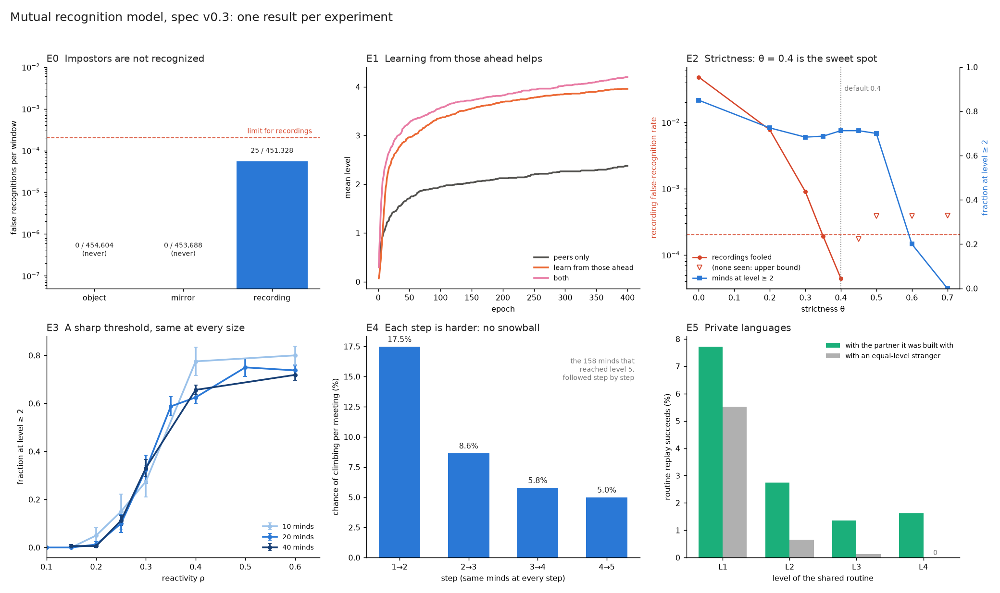

# GraphPhenomenology

A toy simulation of **mutual recognition**: can some kinds of awareness only grow *between* two minds, through each recognizing the other, and does that growth come smoothly or in steps?

The idea comes from Fichte's "summons", Hegel's account of mutual recognition, Husserl's "pairing", Mead and Vygotsky on the social self, and infant studies of proto-conversation, the still face and live-versus-replayed video. The model takes a few of these ideas and makes them precise enough to test. It is not a theory of mind.



## The model in brief

- **A mind** is a labelled directed graph: vertices are states, and edges are moves a₁…a₃, their complements ā₁…ā₃, or the solo move τ. Each mind starts with 16 vertices and random edges.
- **Two minds meet** by taking turns. An offer goes through only when the partner answers with the complementary move, so a pair walks on the product of the two graphs.
- **Recognition** needs three things in the same window:
  - a *joint cycle*: I offer and you accept, then you offer and I accept;
  - *contingency*: your answers depend on my offers;
  - *mutuality*: both minds pass.
- **Levels.** Each recognition is stored as a nested record. A mind climbs further by replaying a record with a partner and extending it. Each step up also grows the mind's graph.
- **Controls** test the criterion: objects (never initiate, answer at random), mirrors (never initiate, answer perfectly) and recordings (replay a real mind, ignoring the partner).

The full definition is in [`mutual-recognition-model-spec.md`](mutual-recognition-model-spec.md) (v0.3).

## What we found

| Hypothesis | Verdict |
|---|---|
| Impostors aren't recognized | Objects and mirrors never; recordings in 0.006% of checks, by chance |
| Development has a sharp threshold | Yes in reactivity (ρ ≈ 0.31), but it is a per-encounter threshold that doesn't sharpen with population size |
| Development feeds on itself | **No.** Each level is harder to reach than the last, even for the same minds |
| Partners who climb together form a private language | **Yes.** A shared routine succeeds 3.7× as often with its co-builder as with an equal-level stranger |
| Credulity buys speed | Lower thresholds speed early development and get fooled more, but don't raise the final level |

The full write-up is [`results/SYNTHESIS.md`](results/SYNTHESIS.md). Each experiment has its own report in `results/E*_v03.md`; the earlier v0.2 reports are kept alongside for comparison.

## Running it

Requires Python ≥ 3.12 and [uv](https://docs.astral.sh/uv/).

```bash
uv run pytest -q                                                 # 218 tests
uv run python -m sim.runner --config experiments/default.yaml    # one run, defaults
uv run python -m experiments.sweep --config experiments/default.yaml --tag demo --seeds 4 --grid rho=0.2,0.3,0.5
uv run python -m experiments.G5_overview                         # summary figure (needs the saved outputs)
```

Runs are deterministic given a seed. Outputs go to `outputs/`, which is not committed. The exact commands behind each result are in its report.

## Layout

| Path | Contents |
|---|---|
| `model/` | Graphs, records, agents, controls, configuration |
| `sim/` | Episode loop, recognition check, runner |
| `analysis/` | Metrics and the product-graph analysis |
| `experiments/` | Configs and scripts for C0 and E0–E5, sweeps, plots |
| `results/` | Write-ups and figures |
| `NOTEBOOK.md` | Lab notebook: every experiment, decision and coined term |

Tags: `v0.2-results` (before the grown-node fix) and `v0.3-results` (current results).

## History

The work ran in gated segments, logged in [`NOTEBOOK.md`](NOTEBOOK.md). One design error shaped the first round of results: grown vertices had no way out, so developed minds got stuck. Spec v0.3 fixed this (decision D10). Every experiment was then re-run, and several first-round conclusions reversed.
