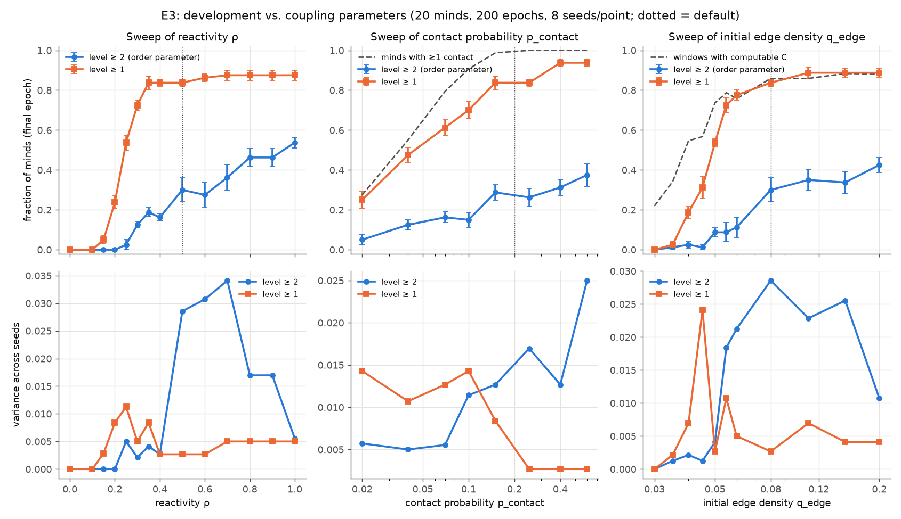
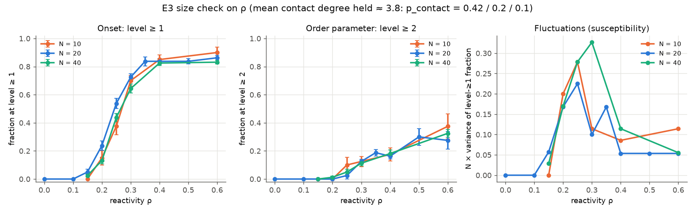

# E3 — Phase transition (spec §10)

**Question.** Is there a sharp threshold in development as coupling increases? We swept reactivity ρ, contact probability p_contact and initial edge density q_edge, one at a time. The order parameter is the fraction of minds at level ≥ 2 at the final epoch, written φ below.

## 1. Plain summary

We varied three settings that control how easily the simulated agents can connect: how readily they answer each other, how many others they can meet, and how many moves are open to them at the start. For each setting, we counted how many agents got past the second stage of mutual recognition. Only one setting has a clear tipping point. When an agent answers "in kind" less than about 20–30% of the time, nothing develops. Above that, most agents take the first step, but the curve bends over gradually rather than snapping. The tipping point stayed in the same place and kept the same steepness for populations of 10, 20 and 40 agents. So it behaves like a threshold built into each individual encounter, not like a collective "phase change". The other two settings produce smooth curves, and their lower ends mostly show that agents cannot interact at all (they have no one to meet, or too few moves to make the recognition test measurable).

## 2. Method

- **Base config:** `experiments/E3.yaml` = the defaults (q_edge 0.08, θ 0.4, ρ 0.5, p_contact 0.2, N_agents 20, ER contact, bootstrap mode, no controls) with **epochs = 200** (not 500), to fit the compute budget.
- **Seeds:** 8 per grid point (seeds 0–7). Error bars are ± 1 standard error across seeds; "var" is the across-seed variance of φ (ddof = 1).
- **Secondary quantities:** the fraction at level ≥ 1 (`ge1`); the fraction of final-epoch windows in which contingency was computable (`comp`, last epoch only); and, for p_contact, the fraction of minds with at least one contact edge. That last one is recomputed by replaying the runner's RNG stream up to `build_contact`.
- **Size check:** the ρ sweep repeated at N = 10 and N = 40. **Judgment call:** p_contact was scaled to hold the mean contact degree at ≈ 3.8 (N=10: 0.42, N=20: 0.2, N=40: 0.1). Leaving p_contact at 0.2 would change two things at once.
- **Stranding diagnostic** (`experiments/E3_stranding.py`): at the base config, over 6 seeds, how many minds end with no contact neighbour at their own level? Under bootstrap mode such a mind can never level up again.
- **Budget:** 360 sweep runs plus 6 diagnostic runs, at about 11 CPU-s each for N = 20. That is about 26 min wall time on 3 workers.

Commands (from the repo root; the sweeps write to `outputs/<tag>/sweep.json`):

```
S="uv run python -m experiments.sweep --config experiments/E3.yaml --seeds 8 --workers 3"
$S --tag E3_rho_coarse --grid rho=0.0,0.1,0.2,0.3,0.4,0.5,0.6,0.7,0.8,0.9,1.0
$S --tag E3_p_coarse   --grid p_contact=0.02,0.04,0.07,0.1,0.15,0.25,0.4,0.6
$S --tag E3_q_coarse   --grid q_edge=0.03,0.04,0.05,0.06,0.08,0.11,0.15,0.2
$S --tag E3_rho_fine   --grid rho=0.15,0.25,0.35
$S --tag E3_rho_N10    --set N_agents=10 p_contact=0.42 --grid rho=0.15,0.2,0.25,0.3,0.4,0.6
$S --tag E3_rho_N40    --set N_agents=40 p_contact=0.1  --grid rho=0.15,0.2,0.25,0.3,0.4,0.6
$S --tag E3_q_fine     --grid q_edge=0.035,0.045,0.055
uv run python -m experiments.E3_stranding --seeds 6
uv run python -m experiments.E3_analyze E3_rho_coarse E3_rho_fine --axis rho     # tables
uv run python -m experiments.E3_analyze E3_p_coarse --axis p_contact --isolation
uv run python -m experiments.E3_analyze E3_q_coarse E3_q_fine --axis q_edge
uv run python -m experiments.E3_plot     # results/E3_sweeps.png, E3_size.png, E3_summary.json
```

## 3. Results



### ρ (reactivity), N = 20

| ρ | φ = level ≥ 2 (± SE) | var φ | level ≥ 1 (± SE) | computable |
|---|---|---|---|---|
| 0 | 0.000 ± 0.000 | 0 | 0.000 ± 0.000 | 0.99 |
| 0.1 | 0.000 ± 0.000 | 0 | 0.000 ± 0.000 | 0.99 |
| 0.15 | 0.000 ± 0.000 | 0 | 0.050 ± 0.019 | 0.97 |
| 0.2 | 0.000 ± 0.000 | 0 | 0.238 ± 0.032 | 0.94 |
| 0.25 | 0.025 ± 0.025 | 0.0050 | 0.537 ± 0.037 | 0.88 |
| 0.3 | 0.125 ± 0.016 | 0.0021 | 0.725 ± 0.025 | 0.84 |
| 0.35 | 0.188 ± 0.023 | 0.0041 | 0.838 ± 0.032 | 0.89 |
| 0.4 | 0.163 ± 0.018 | 0.0027 | 0.838 ± 0.018 | 0.85 |
| 0.5 | 0.300 ± 0.060 | 0.0286 | 0.838 ± 0.018 | 0.86 |
| 0.6 | 0.275 ± 0.062 | 0.0307 | 0.863 ± 0.018 | 0.86 |
| 0.7 | 0.362 ± 0.065 | 0.0341 | 0.875 ± 0.025 | 0.89 |
| 0.8 | 0.463 ± 0.046 | 0.0170 | 0.875 ± 0.025 | 0.87 |
| 0.9 | 0.462 ± 0.046 | 0.0170 | 0.875 ± 0.025 | 0.87 |
| 1.0 | 0.537 ± 0.026 | 0.0055 | 0.875 ± 0.025 | 0.92 |

### p_contact, N = 20

| p_contact | φ (± SE) | var φ | level ≥ 1 (± SE) | minds with ≥ 1 contact |
|---|---|---|---|---|
| 0.02 | 0.050 ± 0.027 | 0.0057 | 0.250 ± 0.042 | 0.27 |
| 0.04 | 0.125 ± 0.025 | 0.0050 | 0.475 ± 0.037 | 0.55 |
| 0.07 | 0.163 ± 0.026 | 0.0055 | 0.612 ± 0.040 | 0.79 |
| 0.1 | 0.150 ± 0.038 | 0.0114 | 0.700 ± 0.042 | 0.91 |
| 0.15 | 0.288 ± 0.040 | 0.0127 | 0.838 ± 0.032 | 0.99 |
| 0.25 | 0.263 ± 0.046 | 0.0170 | 0.838 ± 0.018 | 1.00 |
| 0.4 | 0.312 ± 0.040 | 0.0127 | 0.938 ± 0.018 | 1.00 |
| 0.6 | 0.375 ± 0.056 | 0.0250 | 0.938 ± 0.018 | 1.00 |

### q_edge, N = 20

| q_edge | φ (± SE) | var φ | level ≥ 1 (± SE) | computable |
|---|---|---|---|---|
| 0.03 | 0.000 ± 0.000 | 0 | 0.000 ± 0.000 | 0.22 |
| 0.035 | 0.013 ± 0.013 | 0.0013 | 0.025 ± 0.016 | 0.34 |
| 0.04 | 0.025 ± 0.016 | 0.0021 | 0.188 ± 0.030 | 0.55 |
| 0.045 | 0.013 ± 0.013 | 0.0013 | 0.312 ± 0.055 | 0.57 |
| 0.05 | 0.088 ± 0.023 | 0.0041 | 0.538 ± 0.018 | 0.74 |
| 0.055 | 0.087 ± 0.048 | 0.0184 | 0.725 ± 0.037 | 0.79 |
| 0.06 | 0.113 ± 0.052 | 0.0213 | 0.775 ± 0.025 | 0.76 |
| 0.08 | 0.300 ± 0.060 | 0.0286 | 0.838 ± 0.018 | 0.86 |
| 0.11 | 0.350 ± 0.053 | 0.0229 | 0.888 ± 0.030 | 0.86 |
| 0.15 | 0.338 ± 0.056 | 0.0255 | 0.887 ± 0.023 | 0.88 |
| 0.2 | 0.425 ± 0.037 | 0.0107 | 0.887 ± 0.023 | 0.88 |

### Size check on ρ (mean degree ≈ 3.8)



| ρ | level ≥ 1, N=10 | N=20 | N=40 | φ, N=10 | N=20 | N=40 |
|---|---|---|---|---|---|---|
| 0.15 | 0.000 | 0.050 ± 0.019 | 0.025 ± 0.009 | 0.000 | 0.000 | 0.000 |
| 0.2 | 0.150 ± 0.050 | 0.238 ± 0.032 | 0.131 ± 0.023 | 0.000 | 0.000 | 0.013 ± 0.008 |
| 0.25 | 0.375 ± 0.059 | 0.537 ± 0.037 | 0.438 ± 0.030 | 0.100 ± 0.053 | 0.025 ± 0.025 | 0.050 ± 0.019 |
| 0.3 | 0.700 ± 0.038 | 0.725 ± 0.025 | 0.644 ± 0.032 | 0.125 ± 0.037 | 0.125 ± 0.016 | 0.113 ± 0.018 |
| 0.4 | 0.850 ± 0.033 | 0.838 ± 0.018 | 0.825 ± 0.019 | 0.175 ± 0.045 | 0.163 ± 0.018 | 0.181 ± 0.027 |
| 0.6 | 0.900 ± 0.038 | 0.863 ± 0.018 | 0.831 ± 0.013 | 0.375 ± 0.088 | 0.275 ± 0.062 | 0.325 ± 0.027 |

The onset slope of level ≥ 1 between ρ = 0.2 and 0.3 is about 5.5 per unit ρ at N = 10, 4.9 at N = 20 and 5.1 at N = 40, so it does not steepen with N. The fluctuation measure N × var(level ≥ 1) peaks at 0.28 (N=10, ρ=0.25), 0.23 (N=20, ρ=0.25) and 0.33 (N=40, ρ=0.3). With 8 seeds these differences are noise, and there is no systematic growth with N.

### Stranding diagnostic (base config, 6 seeds, 120 minds, 200 epochs)

| final level | minds | with an equal-level neighbour |
|---|---|---|
| 0 | 20 | **0** |
| 1 | 62 | 59 |
| 2 | 24 | 24 |
| ≥ 3 | 14 | 14 |

The last epoch with any level-up was 19, 163, 41, 92, 197 and 172 in the six seeds.

## 4. Interpretation

- **ρ has the only threshold-like feature, and it is at the first rung.** Level ≥ 1 goes from 5% to 84% as ρ rises from 0.15 to 0.35. Contingency stays computable across this range (≥ 0.84), so the onset is not a measurability artifact. It is the §5.2 statistic crossing θ = 0.4. A mind with reactivity ρ scores a pooled lift C of roughly ρ × P(complement available), plus noise from about 20 offers per window. Over hundreds of windows, the upper tail reaches θ once ρ is about 0.2–0.3. The order parameter φ (level ≥ 2) starts about 0.05 higher in ρ and then rises roughly linearly, with no sharp step, from 0.13 at ρ = 0.3 to 0.54 at ρ = 1.
- **It is a crossover, not a phase transition.** Across N = 10, 20 and 40 at fixed mean degree, the onset stays at the same place with the same width, and the fluctuation peak does not grow. That is the signature of a threshold within each encounter, set by θ and the window statistics, not of a collective transition. Its steepness should depend on W and n_min_total, not on N (untested).
- **p_contact: no threshold beyond the contact graph's own.** Level ≥ 1 follows the fraction of minds with any contact (0.25 vs 0.27 at p = 0.02, 0.61 vs 0.79 at 0.07). Dividing φ by the connected fraction gives about 0.18–0.23 for p ≤ 0.1 and 0.26–0.38 above. That is a weak, smooth rise. The lower end of this sweep is the Erdős–Rényi connectivity threshold (p ≈ ln N / N ≈ 0.15 for N = 20), not recognition dynamics.
- **q_edge: onset at 0.04–0.06, largely the C0-diag artifact.** Level ≥ 1 rises from 3% to 78% between q = 0.035 and 0.06, tracking the fraction of windows where contingency is computable (0.34 → 0.76). Below about 0.05, agents mostly cannot run the recognition test. Above 0.08, φ is flat within error (0.30–0.43).
- **Why φ tops out around 0.3 at the defaults: slow kinetics, not freezing.** Minds stuck at level 0 (12–16% at ρ ≥ 0.4) are truly stranded: none of them has a level-0 neighbour left, and under bootstrap mode they can never move again. But 59 of the 62 level-1 minds still have a level-1 neighbour. The 1 → 2 step is limited by how rarely it happens (a successful probe plus an extra, mutually, in the same window; probe success is 1–3% per D7), not by the lack of a partner.

## 5. Surprises and caveats

- **The default ρ = 0.5 sits on a shoulder.** Level ≥ 1 saturates at ρ ≈ 0.35, but φ keeps climbing up to ρ = 1. The model is not near its onset at the defaults.
- **The variance peak for φ is not at the onset.** var(φ) is largest at ρ = 0.5–0.7 and q_edge = 0.08–0.15 (about 0.03). That is roughly 3× the binomial value 0.3·0.7/20 ≈ 0.011, meaning whole runs are lucky or unlucky together (a cascade to high levels in some seeds). This is run-to-run overdispersion in the level-2+ plateau, not critical fluctuation.
- **Level ≥ 1 saturates at 84–94%, not 100%,** because of stranding under bootstrap (see above). It is an absorbing-state effect of the equal-level rule. Higher p_contact reduces it (94% at p ≥ 0.4).
- **Finite time.** At 200 epochs (not 500), φ is still rising between epochs 100 and 200 near the onset (at ρ = 0.3, 0.075 → 0.125). Longer runs would probably shift the ρ onset somewhat left and raise φ. Elsewhere, φ at epoch 100 is within 0.015 of φ at epoch 200, so the plateau has been reached.
- 8 seeds per point; SE ≈ 0.02–0.06. `computable` is from the final epoch only (the sweep tool keeps only the last row).
- The N = 10 and N = 40 checks change p_contact along with N (to hold degree fixed). This is the right comparison, but it is not a pure change of N.

## 6. Suggested follow-ups

1. Sweep ρ at two window sizes (W = 50 vs 100, with n_min_total scaled). If the onset sharpens with W rather than N, that confirms it is a per-window statistical threshold.
2. Run the ρ onset (0.15–0.35) at 500 epochs to measure the finite-time drift.
3. Repeat the stranding diagnostic in `mixed` mode. Elder transmission should rescue stranded level-0 minds (an E1 tie-in), and it would show whether the level-≥1 ceiling is purely a bootstrap-mode artifact.
4. Use a 2-D ρ × θ grid. The onset should track ρ_c ∝ θ if the per-encounter explanation is right.
