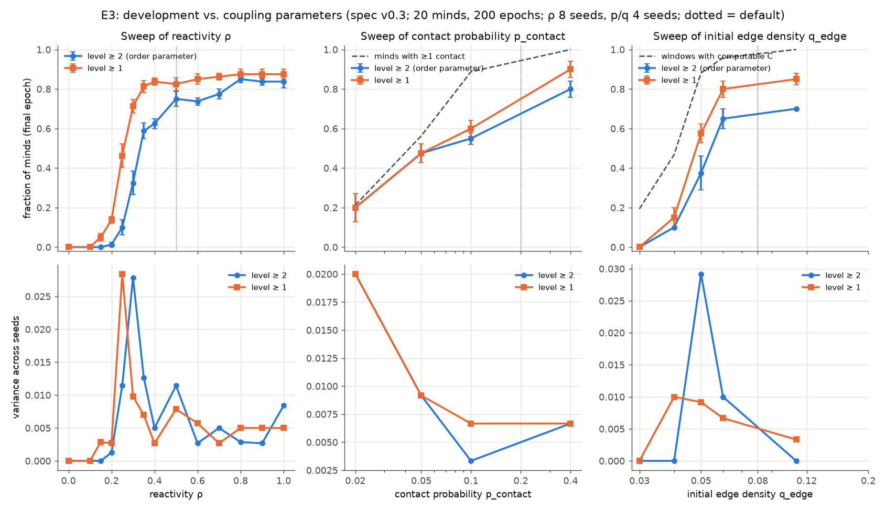
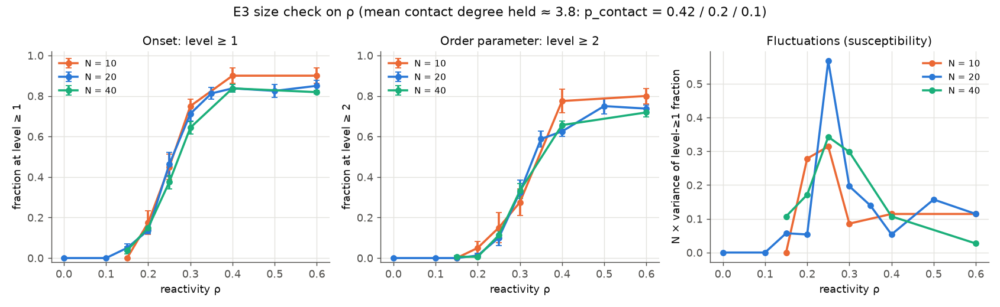

# E3 under spec v0.3 — Phase transition re-run

**Question (unchanged, spec §10).** Is there a sharp threshold in development as coupling increases? Now that grown nodes have a τ exit (D10), does any sweep show a threshold that **sharpens with system size**? The order parameter φ is the fraction of minds at level ≥ 2 at the final epoch. The v0.2 baseline is `results/E3.md` (tag `v0.2-results`).

## 1. Plain summary

With the trap removed, most agents that take the first step now also take the second, so the share of agents past the second stage roughly doubles (from about 30% to about 75% at the default settings). The "answer in kind" setting now has a clear tipping point for the second stage too: below about 25% nothing develops, and by about 35–40% most agents have developed. But that tipping point has the same position and the same steepness for 10, 20 and 40 agents. So it is still a threshold built into each individual encounter, not a collective change that gets sharper in bigger groups. What now limits development is mostly agents left with nobody at their own stage to pair with, not how rarely the second step happens.

## 2. Method

Same scripts and base config as v0.2 (`experiments/E3.yaml`: defaults with **200 epochs**), run on the current code (spec v0.3, commit `aebd162`), with **2 worker processes**. Budget: about 38 min of wall time, shared with four other agents' runs on the same machine.

- **Kept from v0.2:** the full ρ sweep (14 points, 8 seeds); the size check at N = 10 / 20 / 40 with mean contact degree held at ≈ 3.8 (p_contact 0.42 / 0.2 / 0.1; 6 points, 8 seeds); and the stranding diagnostic (6 seeds).
- **Trimmed (judgment call, for the budget):** q_edge at 5 points × 4 seeds (0.03, 0.04, 0.05, 0.06, 0.11) and p_contact at 4 points × 4 seeds (0.02, 0.05, 0.1, 0.4). The q_fine refinement was dropped. I prioritized ρ and the size check because ρ changed most (φ at ρ = 0.5 went 0.30 → 0.75).
- **New:** `experiments/E3_onset.py` fits `A / (1 + exp(-(ρ - ρ_c)/w))` to the level ≥ 1 and level ≥ 2 curves over ρ ∈ [0.15, 0.6] for each N (numpy grid search). It gives 95% intervals on ρ_c and the width w from 400 bootstrap resamples of seeds within each grid point. A collective transition predicts that w shrinks with N.
- `experiments/E3_plot.py` gained `--tag-prefix` / `--out-prefix` / `--note`, so the v0.3 figures do not overwrite the v0.2 ones. Its defaults reproduce the v0.2 behaviour.
- Error bars: ± 1 SE across seeds. `var` is the across-seed variance (ddof = 1). `comp` is the contingency-computable fraction of windows, final epoch only.

Commands (from the repo root; the sweeps write to `outputs/<tag>/sweep.json`):

```
S="uv run python -m experiments.sweep --config experiments/E3.yaml --workers 2"
$S --seeds 8 --tag E3v3_rho_coarse --grid rho=0.0,0.1,0.2,0.3,0.4,0.5,0.6,0.7,0.8,0.9,1.0
$S --seeds 8 --tag E3v3_rho_fine   --grid rho=0.15,0.25,0.35
$S --seeds 8 --tag E3v3_rho_N10 --set N_agents=10 p_contact=0.42 --grid rho=0.15,0.2,0.25,0.3,0.4,0.6
$S --seeds 8 --tag E3v3_rho_N40 --set N_agents=40 p_contact=0.1  --grid rho=0.15,0.2,0.25,0.3,0.4,0.6
$S --seeds 4 --tag E3v3_q_coarse --grid q_edge=0.03,0.04,0.05,0.06,0.11
$S --seeds 4 --tag E3v3_p_coarse --grid p_contact=0.02,0.05,0.1,0.4
uv run python -m experiments.E3_stranding --seeds 6
uv run python -m experiments.E3_analyze E3v3_rho_coarse E3v3_rho_fine --axis rho
uv run python -m experiments.E3_analyze E3v3_rho_N10 --axis rho      # and E3v3_rho_N40
uv run python -m experiments.E3_analyze E3v3_q_coarse --axis q_edge
uv run python -m experiments.E3_analyze E3v3_p_coarse --axis p_contact --isolation
uv run python -m experiments.E3_onset --prefix E3v3
uv run python -m experiments.E3_plot --tag-prefix E3v3 --out-prefix results/E3_v03 \
    --note "spec v0.3; 20 minds, 200 epochs; ρ 8 seeds, p/q 4 seeds"
```

These write `results/E3_v03_sweeps.png`, `results/E3_v03_size.png` and `results/E3_v03_summary.json`.

## 3. Results (v0.3)



### ρ (reactivity), N = 20, 8 seeds

| ρ | φ = level ≥ 2 (± SE) | var φ | φ at epoch 100 | level ≥ 1 (± SE) | computable |
|---|---|---|---|---|---|
| 0 | 0.000 ± 0.000 | 0 | 0.000 | 0.000 | 0.99 |
| 0.1 | 0.000 ± 0.000 | 0 | 0.000 | 0.000 | 0.99 |
| 0.15 | 0.000 ± 0.000 | 0 | 0.000 | 0.050 ± 0.019 | 0.99 |
| 0.2 | 0.013 ± 0.013 | 0.001 | 0.013 | 0.138 ± 0.018 | 0.98 |
| 0.25 | 0.100 ± 0.038 | 0.011 | 0.013 | 0.463 ± 0.060 | 0.98 |
| 0.3 | 0.325 ± 0.059 | 0.028 | 0.175 | 0.712 ± 0.035 | 1.00 |
| 0.35 | 0.588 ± 0.040 | 0.013 | 0.463 | 0.812 ± 0.030 | 1.00 |
| 0.4 | 0.625 ± 0.025 | 0.005 | 0.575 | 0.838 ± 0.018 | 0.99 |
| 0.5 | 0.750 ± 0.038 | 0.011 | 0.700 | 0.825 ± 0.031 | 1.00 |
| 0.6 | 0.738 ± 0.018 | 0.003 | 0.713 | 0.850 ± 0.027 | 1.00 |
| 0.7 | 0.775 ± 0.025 | 0.005 | 0.775 | 0.863 ± 0.018 | 0.99 |
| 0.8 | 0.850 ± 0.019 | 0.003 | 0.850 | 0.875 ± 0.025 | 1.00 |
| 0.9 | 0.838 ± 0.018 | 0.003 | 0.812 | 0.875 ± 0.025 | 0.99 |
| 1.0 | 0.838 ± 0.032 | 0.008 | 0.838 | 0.875 ± 0.025 | 1.00 |

(The level ≥ 1 SEs are read off `E3_v03_summary.json`.)

### Size check on ρ (mean degree ≈ 3.8, 8 seeds per point)



| ρ | level ≥ 1, N=10 | N=20 | N=40 | φ, N=10 | N=20 | N=40 |
|---|---|---|---|---|---|---|
| 0.15 | 0.000 | 0.050 | 0.038 | 0.000 | 0.000 | 0.006 ± 0.006 |
| 0.2 | 0.175 | 0.138 | 0.150 | 0.050 ± 0.033 | 0.013 ± 0.013 | 0.006 ± 0.006 |
| 0.25 | 0.450 | 0.463 | 0.375 | 0.150 ± 0.073 | 0.100 ± 0.038 | 0.113 ± 0.021 |
| 0.3 | 0.750 | 0.712 | 0.644 | 0.275 ± 0.065 | 0.325 ± 0.059 | 0.331 ± 0.035 |
| 0.4 | 0.900 | 0.838 | 0.838 | 0.775 ± 0.059 | 0.625 ± 0.025 | 0.656 ± 0.020 |
| 0.6 | 0.900 | 0.850 | 0.819 | 0.800 ± 0.038 | 0.738 ± 0.018 | 0.719 ± 0.023 |

**Logistic fits** (`E3_onset.py`, ρ ∈ [0.15, 0.6], 95% seed-bootstrap intervals):

| curve | N | plateau A | ρ_c [95%] | width w [95%] |
|---|---|---|---|---|
| level ≥ 1 | 10 | 0.90 | 0.250 [0.235, 0.260] | 0.032 [0.022, 0.040] |
| level ≥ 1 | 20 | 0.84 | 0.245 [0.235, 0.258] | 0.030 [0.023, 0.035] |
| level ≥ 1 | 40 | 0.84 | 0.258 [0.250, 0.265] | 0.036 [0.030, 0.041] |
| φ (level ≥ 2) | 10 | 0.82 | 0.318 [0.297, 0.338] | 0.036 [0.021, 0.053] |
| φ (level ≥ 2) | 20 | 0.73 | 0.307 [0.292, 0.323] | 0.034 [0.020, 0.042] |
| φ (level ≥ 2) | 40 | 0.71 | 0.305 [0.292, 0.323] | 0.033 [0.024, 0.040] |

The width does **not** shrink from N = 10 to 40, for either rung. The intervals overlap almost completely. A width ∝ 1/√N would predict w(40) ≈ w(10)/2 ≈ 0.017, which lies outside every N = 40 interval. The susceptibility N·var(φ) peaks at 0.43 (N = 10, ρ = 0.25), 0.56 (N = 20, ρ = 0.3) and 0.40 (N = 40, ρ = 0.3), with no growth with N.

### q_edge, N = 20, 4 seeds

| q_edge | φ (± SE) | level ≥ 1 | computable |
|---|---|---|---|
| 0.03 | 0.000 ± 0.000 | 0.000 | 0.19 |
| 0.04 | 0.100 ± 0.000 | 0.150 | 0.47 |
| 0.05 | 0.375 ± 0.085 | 0.575 | 0.88 |
| 0.06 | 0.650 ± 0.050 | 0.800 | 0.96 |
| 0.08 (base, 8 seeds) | 0.750 ± 0.038 | 0.825 | 1.00 |
| 0.11 | 0.700 ± 0.000 | 0.850 | 1.00 |

### p_contact, N = 20, 4 seeds

| p_contact | φ (± SE) | level ≥ 1 | minds with ≥ 1 contact |
|---|---|---|---|
| 0.02 | 0.200 ± 0.071 | 0.200 | 0.21 |
| 0.05 | 0.475 ± 0.048 | 0.475 | 0.56 |
| 0.1 | 0.550 ± 0.029 | 0.600 | 0.89 |
| 0.2 (base, 8 seeds) | 0.750 ± 0.038 | 0.825 | ≈ 0.99 (v0.2 value) |
| 0.4 | 0.800 ± 0.041 | 0.900 | 1.00 |

### Stranding diagnostic (base config, 6 seeds, 120 minds, 200 epochs)

| final level | minds | with an equal-level neighbour |
|---|---|---|
| 0 | 22 | **0** |
| 1 | 10 | **0** |
| 2 | 44 | 43 |
| 3 | 32 | 32 |
| 4–8 | 12 | 12 |

Stranded fraction: 0.275. The last epoch with any level-up was 187, 156, 147, 179, 105 and 191 in the six seeds.

## 4. v0.2 → v0.3 side by side

| quantity | v0.2 | v0.3 |
|---|---|---|
| φ at defaults (ρ 0.5) | 0.300 ± 0.060 | **0.750 ± 0.038** |
| level ≥ 1 at defaults | 0.838 ± 0.018 | 0.825 ± 0.031 |
| φ / level ≥ 1 (share of first-steppers that take the second step) | 0.36 | **0.91** |
| φ at ρ = 1 | 0.54 | 0.84 |
| level ≥ 1 onset ρ_c, width w (N = 10/20/40) | 0.26/0.23/0.25; 0.033/0.034/0.034 † | 0.25/0.245/0.26; 0.032/0.030/0.036 |
| φ onset | soft: φ rises roughly linearly from 0.13 (ρ 0.3) to 0.54 (ρ 1) | **sharp**: ρ_c ≈ 0.31, w ≈ 0.034, saturates ≈ 0.75–0.85 by ρ ≈ 0.5 |
| peak N·var(φ), N = 10/20/40 | no peak at the onset; variance maximal at ρ 0.5–0.7 | 0.43/0.56/0.40 at the onset (ρ 0.25–0.3) |
| computable C, defaults | 0.86 | 0.996 |
| minds at level 1 with a level-1 neighbour | 59 / 62 | **0 / 10** |
| stranded fraction | 0.19 | 0.275 |

† v0.2 fits are made to the published per-point means in `results/E3_summary.json`, with no bootstrap, because the v0.2 per-seed outputs are not in the repo. The v0.2 φ curve does not saturate by ρ = 0.6, so a φ width for v0.2 is not meaningful.

**Survives**
- **No collective transition.** ρ is still the only axis with a real threshold, and its onset has the same location and width at N = 10, 20 and 40. That holds now for both rungs (w ≈ 0.03 everywhere). The v0.2 reading, "a per-encounter crossover set by θ and the window statistics", still stands, and the case for it is stronger now that there is a sharp φ step that could have sharpened with N and did not.
- **The level ≥ 1 onset is unchanged** (ρ_c ≈ 0.25, w ≈ 0.03). This makes sense: the v0.3 change only affects minds after their first unlock.
- **p_contact's low end is the contact graph's own threshold.** Level ≥ 1 still tracks the fraction of minds with any contact (0.20 vs 0.21, 0.475 vs 0.56).
- **The level ≥ 1 ceiling (82–90%) comes from stranding** of level-0 minds under bootstrap mode (22 of 22 are stranded).

**Changes**
- **φ now has a sharp onset.** It rises from 0.01 to 0.59 between ρ 0.2 and 0.35 and trails the level ≥ 1 onset by Δρ ≈ 0.06. In v0.2, φ crept upward with no step. The 1 → 2 step is no longer rate-limiting: 91% of minds that reach level 1 reach level 2 (v0.2: 36%).
- **The "φ ≈ 0.3 ceiling" is gone.** φ is 0.75 at the defaults and about 0.84 at high ρ. The v0.2 explanation (a rare 1 → 2 step, slow kinetics) was an artifact of the trap, as D9 suspected.
- **What limits development now is stranding, not kinetics.** In v0.2, 59 of the 62 level-1 minds still had a level-1 partner and were just slow. In v0.3, every mind stuck at level 0 or 1 (32 of 120) has no equal-level contact neighbour. Everyone who could move on did. Under bootstrap mode, the ceiling on φ is now set by how the contact graph pairs equal levels, and the stranded fraction rose from 0.19 to 0.275 because fast climbers leave their slower neighbours behind.
- **q_edge: the φ onset now follows computability closely.** φ rises from 0.10 to 0.65 between q 0.04 and 0.06, while computable C goes from 0.47 to 0.96. The v0.2 reading (the low end is the C0-diag artifact) survives, but above q ≈ 0.06, φ is now high (0.65–0.75) instead of a noisy 0.1–0.3.
- **The variance peak moved to the onset.** In v0.2, var(φ) was largest on the plateau (ρ 0.5–0.7), from run-to-run cascades. In v0.3 it peaks at the onset (ρ 0.3, q 0.05), as expected for a steep curve. It is the ordinary broadening of a steep curve, because it does not grow with N.

**Reverses:** none of the headline conclusions. The one reversal is the mechanism behind the level-1 → level-2 bottleneck: v0.2 said it was slow kinetics, while v0.3 shows the bottleneck gone and the remaining limit set by stranding.

## 5. Caveats

- **Finite time near the onset.** At ρ = 0.3 and 0.35, φ is still rising between epoch 100 and 200 (0.175 → 0.325, 0.46 → 0.59). The φ onset would shift left somewhat at 500 epochs. This affects ρ_c, not the N comparison, because all sizes share the same epoch count. On the plateau (ρ ≥ 0.5), φ at epoch 100 is within 0.05 of φ at epoch 200.
- **p_contact and q_edge have 4 seeds and few points.** Their SEs (up to 0.085) are rough, and the q_edge points at 0.04 and 0.11 have SE 0 by coincidence (all 4 seeds gave the same φ). The base point in those tables is the 8-seed ρ = 0.5 run.
- **N spans only a factor of 4 (10 → 40).** The sizes are in the same range as in v0.2, so this rules out a width shrinking like 1/√N, but not a weak, logarithmic sharpening. The width intervals are ±25–40%.
- **Grid resolution.** The ρ grid spacing near the onset (0.05) is larger than the fitted width (≈ 0.03). The fits rest on 3–4 points on the rise, so w is resolved but coarse.
- The size check changes p_contact along with N, to hold degree fixed, as in v0.2.
- `computable` is from the final epoch only.
- The machine was shared with four other experiment runs, which affects wall time but not results. All runs are seeded and deterministic.

## 6. Suggested follow-ups

1. **Mixed mode (elder transmission) at the default ρ.** Stranding is now the main limit. Elders should rescue stranded level-0 and level-1 minds, and that would show how much of the ~15–25% gap is a bootstrap-mode artifact.
2. **Onset at W = 50 vs 100.** If w changes with W but not N, the per-window statistical origin of the threshold is confirmed.
3. **A finer ρ grid (0.2–0.4, step 0.025) at N = 20 and 80 with 500 epochs.** This is the definitive sharpening check, now that the φ step is steep enough to resolve.
4. **Contact topology.** With stranding the limit, φ should depend on how equal-level pairs are spread over the graph (clustering, degree), not on N. That sweep would target the new bottleneck directly.
