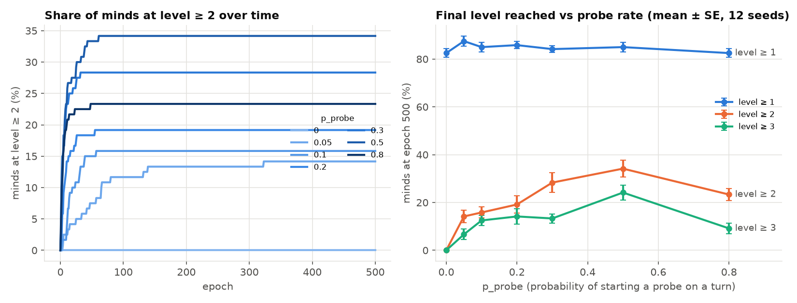
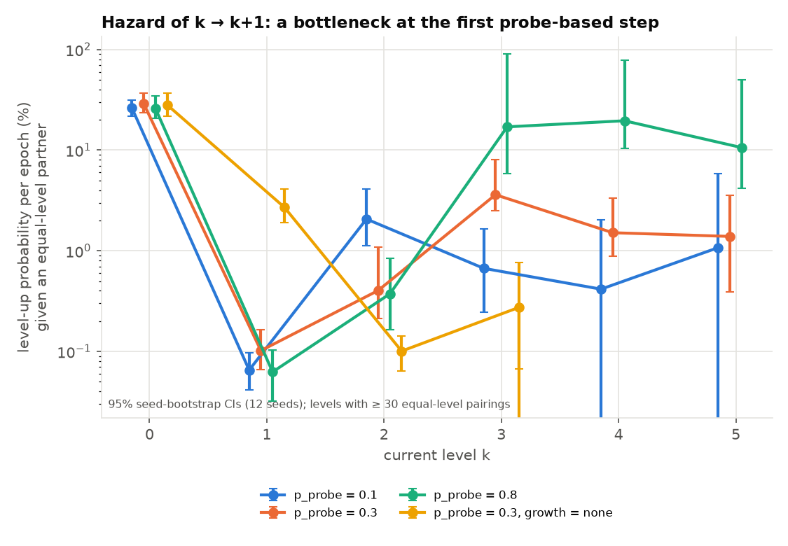
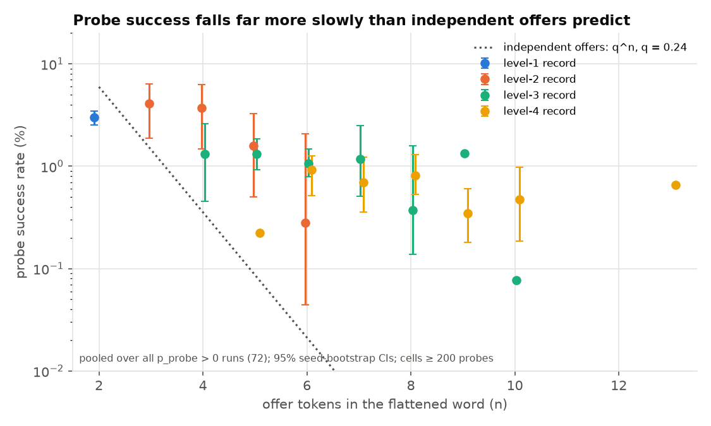

# E4 — Autocatalysis (spec §10)

**Question.** Do probes accelerate development, and does development feed on itself (the hazard of the next step rising with depth)?
**Verdict.** Probes are necessary and, up to a point, speed things up. There is **no clean autocatalysis**. The dominant feature is a severe bottleneck at the first probe-based step (1 → 2). The main cause is an unintended **absorbing-node trap** created by `generalize` growth (§6).

## 1. Plain summary

We asked whether practising what you have learned makes further learning come faster and faster. Practice is essential: without it, nobody gets past the first step. A moderate amount of practice (about one attempt in three to one in two) gets the most individuals furthest. Too much practice backfires. But learning does not snowball. The second step is by far the hardest, about 300 times harder than the first. It is hard mostly because of a side effect of how the model rewards learning. Each success opens a new "room" in the learner's world that has no exit, so learners get locked into a tiny vocabulary they share only with the partner they learned it with. The few pairs who get past the second step keep climbing together, almost always with the same partner.

## 2. Method and commands

Defaults (`experiments/default.yaml`): 20 minds, ER contact p = 0.2, 500 epochs, T_ep = 200, W = 50, q_edge = 0.08, θ = 0.4, ρ = 0.5, β = 1, bootstrap mode, growth `generalize`. 12 seeds (0–11) per condition.

`experiments/E4.py` is a run loop that reproduces `sim.runner.run` exactly. I verified identical trace hashes and metric rows on a test run. It additionally records:
- each mind's level at the start of every epoch;
- each mind's partner every epoch;
- every probe's outcome (success, abort, or cut off by episode end), keyed by record level, flat word length and number of offer tokens;
- per-token and per-position pass counts.

I didn't use `experiments/sweep.py`, because it keeps only final rows and the ≥2 curve, and the hazard analysis needs per-mind level trajectories. Outputs go to `outputs/` (gitignored).

```bash
# (a)+(b)+(c): p_probe sweep, 7 × 12 runs, ~17 min wall on 3 workers
uv run python -m experiments.E4 --tag E4_pprobe --seeds 12 --workers 3 --grid p_probe=0,0.05,0.1,0.2,0.3,0.5,0.8
# (d): growth ablation at p_probe = 0.3 (the generalize arm is the p_probe=0.3 runs above), ~2 min
uv run python -m experiments.E4 --tag E4_growth --seeds 12 --workers 3 --grid growth=none
# tables (results/E4_tables.md), figures (results/E4_*.png), outputs/E4_summary.json
uv run python -m experiments.E4_analyze
# diagnostics
uv run python -m experiments.E4_traps    # absorbing-node census, seeds 0–5, both growth modes (~2 min)
uv run python -m experiments.E4_repeat   # same-partner share of level-ups beyond level 1
```

**Hazard definition.** For a mind at level k at the start of epoch e, h_eq(k) = P(its level is higher at the start of epoch e+1 | its partner in epoch e is a mind at the same level k). Under bootstrap mode, equal levels are required for a level-up. I checked that every level-up occurred in such a pairing, so conditioning on it removes the confound that equal-level partners get scarcer at high k. The table in `results/E4_tables.md` also gives the raw (unconditional) hazard.

**Uncertainty.** Per-run quantities are reported as mean ± SE over 12 seeds. Pooled rates (hazards, probe success) use 95% cluster-bootstrap intervals that resample seeds.

Full tables: `results/E4_tables.md`.

## 3. Results

### (a) The trivial comparison, then the dose–response

**p_probe = 0 caps everyone at level 1, by construction.** Under §5.3, k ≥ 1 → k+1 requires a successful probe of the top record. The data confirm it: 0 level-ups beyond level 1 in 69,058 equal-level level-1 pairings. So "probes accelerate development" is trivially true and carries no information. The real questions are the dose–response and the shape of the hazard.

| p_probe | mean level | ≥1 | ≥2 | ≥3 | max (median [range]) | first pair at L2 (epoch) | first pair at L3 (epoch) | contingency computable |
|---|---|---|---|---|---|---|---|---|
| 0 | 0.83 ± 0.02 | 83 ± 2% | 0% | 0% | 1 | never | never | 75% |
| 0.05 | 1.09 ± 0.05 | 88 ± 2% | 14 ± 3% | 7 ± 2% | 2 [1–4] | 42 [4–80] (11/12) | 88 [58–414] (6/12) | 75% |
| 0.1 | 1.24 ± 0.07 | 85 ± 2% | 16 ± 2% | 13 ± 2% | 4 [1–9] | 12 [2–32] (11/12) | 56 [33–263] (11/12) | 77% |
| 0.2 | 1.39 ± 0.12 | 86 ± 1% | 19 ± 4% | 14 ± 3% | 4 [1–10] | 5 [1–13] (10/12) | 18 [8–37] (9/12) | 84% |
| 0.3 | 1.57 ± 0.09 | 84 ± 1% | 28 ± 4% | 13 ± 2% | 5 [2–10] | 2 [1–8] (12/12) | 7 [5–68] (11/12) | 88% |
| **0.5** | **2.20 ± 0.15** | 85 ± 2% | **34 ± 4%** | **24 ± 3%** | 8 [5–10] | 2 [1–5] (12/12) | 8 [2–44] (12/12) | 87% |
| 0.8 | 1.64 ± 0.17 | 83 ± 2% | 23 ± 3% | 9 ± 2% | 8 [2–10] | 2 [1–6] (12/12) | 6 [1–29] (8/12) | 74% |

Times are the median epoch [range] over the seeds that got there (seeds reaching / 12). Because level-ups are mutual, the "first mind" is always a pair.

- Development rises with p_probe up to 0.5, then falls at 0.8 (level ≥2: 34% → 23%; level ≥3: 24% → 9%). The time to the first level-2 pair drops from ~42 epochs (p = 0.05) to ~2 (p ≥ 0.3).
- **Almost all development happens in the first ~60 epochs, then freezes** (figure `E4_development.png`, left). After epoch ~60 the level ≥2 share barely moves in any condition.
- Level ≥1 is flat at 83–88% for every p_probe. The 12–17% left at level 0 are stranded: all their contacts are already at level 1, and bootstrap needs an equal-level partner.



### (b) Autocatalysis signature: hazard by level

h_eq(k) in % per epoch, with a 95% CI:

| k → k+1 | p = 0.1 | p = 0.3 | p = 0.5 | p = 0.8 | p = 0.3, growth = none |
|---|---|---|---|---|---|
| 0 → 1 | 26 [22, 31] | 29 [24, 37] | 28 [23, 35] | 26 [21, 35] | 28 [22, 37] |
| **1 → 2** | **0.07** [0.04, 0.10] | **0.10** [0.07, 0.17] | **0.17** [0.11, 0.25] | **0.06** [0.03, 0.10] | 2.7 [1.9, 4.1] |
| 2 → 3 | 2.1 [1.1, 4.1] | 0.40 [0.21, 1.1] | 0.96 [0.47, 2.7] | 0.37 [0.16, 0.84] | **0.10** [0.06, 0.14] |
| 3 → 4 | 0.67 [0.24, 1.7] | 3.6 [2.5, 8.1] | 12 [8.4, 27] | 17 [5.8, 90] | 0.27 [0.07, 0.77] |
| 4 → 5 | 0.42 [0, 2.0] | 1.5 [0.88, 3.3] | 2.4 [1.5, 5.0] | 20 [10, 79] | – |
| 5 → 6 | 1.1 [0, 5.9] | 1.4 [0.39, 3.6] | 1.6 [0.95, 3.0] | 11 [4, 50] | – |

- The hazard collapses by a factor of ~150–400 from the recognition-only step (0 → 1, ~27%) to the first probe-based step (1 → 2, 0.06–0.17%). This is the opposite of autocatalysis at the first step.
- Beyond the bottleneck, the hazard rises again (1 → 2 < 2 → 3 < 3 → 4 at p ≥ 0.3), reaching 4–20% per epoch at k = 3–5. On its face this is autocatalytic. But it comes from a few pairs (CIs span an order of magnitude), and it is confounded by selection: only the pairs that got through the bottleneck are observed at k ≥ 2 (see §4).
- More probing mostly helps after the bottleneck: at p = 0.8 the 3 → 5 hazards are 10–20%. At the bottleneck itself, p = 0.8 is worse than p = 0.5.



### (c) Why probe success is low (D7 follow-up)

Pooled over all 72 runs with p_probe > 0 (≈ 16 M probes):

| record level | 1 | 2 | 3 | 4 | 5–10 |
|---|---|---|---|---|---|
| mean flat length | 2.0 | 5.1 | 7.9 | 10.8 | 13.5–24.4 |
| probe success | 3.0% [2.5, 3.4] | 3.6% [1.9, 5.2] | 1.2% [0.9, 1.5] | 0.66% [0.50, 0.89] | 0.7–1.3% |

- **Success does fall with level and length, but far more slowly than length alone predicts.** Offer tokens pass at 27.9% (SELF_OFFER) and 21.4% (OTHER_OFFER); wildcards and τ always pass. If offers passed independently, success would be q^n with q = 0.24. That is 0.36% at 4 offers and 10⁻⁴% at 10 offers. Observed: 3.6% at 4 offers and 0.5–1.2% at 9–14 offers (figure `E4_probe_success.png`).
- **The filter is the first exchange.** The pass rate is 26% at position 0 (my first offer) and 17% at position 1 (the partner's first offer), then 70–95% at every later position. Together the first two positions give 4.4%, which matches level-1 success (3.0%, the remainder being episode-end cut-offs and position effects). A probe that gets through the opening is usually running against a partner that can follow it.
- So the D7 hypothesis, "longer flat words are the reason", is **only partly right**. Length costs about a factor of 3–5 from level 1–2 to level ≥3. The low base rate (~3%) comes from the opening exchange, which fails because the partner usually cannot answer (next section).



### (d) Growth `generalize` vs `none` (p_probe = 0.3, 12 seeds each)

| growth | ≥1 | ≥2 | ≥3 | max level | h_eq 1 → 2 | contingency computable |
|---|---|---|---|---|---|---|
| generalize | 84 ± 1% | 28 ± 4% | 13 ± 2% | 5 [2–10] | 0.10% | 88% |
| none | 87 ± 1% | **73 ± 1%** | 15 ± 2% | 3 [2–4] | **2.7%** | **99%** |

Without growth, the 1 → 2 step is 27× easier and 73% of minds reach level 2. The bottleneck moves to 2 → 3 (0.10%), and nobody passes level 4. Growth therefore slows early development a lot, but it is what allows the deep climbs (max level 10 vs 4).

**The mechanism: growth creates absorbing nodes.** In `E4_traps`, a node counts as absorbing when all of its out-edges are self-loops. That applies to the node activated on unlock, which gets only a τ self-loop plus the learned-label self-loops, and whose only in-edge comes from the anchor. At the end of 500 epochs (seeds 0–5):

| growth | minds on an absorbing node | sync labels available there | sync labels elsewhere | levels of trapped / free minds |
|---|---|---|---|---|
| generalize | **79%** (95/120) | 1.97 | 3.96 | trapped: 0 at L0, 59 L1, 22 L2, 14 at L4–6. Free: 20 L0, 3 L1, 2 L2 |
| none | 0% | – | 4.38 | – |

95 of the 100 minds at level ≥ 1 had stepped onto a grown node and are stuck there for good. No level-0 mind is. Its only sync labels are the two from its level-1 record. For two minds that co-created a record, those labels interlock by construction: my {a, b̄} against their {ā, b}. For almost anyone else they don't. This explains three things at once:
- the low opening pass rate and the high pass rate after it;
- the drop in contingency computability (88% vs 99%; windows with fewer than 2 labels or too few offers);
- the fact that **89% of level-ups beyond level 1 are with the previous level-up partner** (702/792). Under `none` the figure is 66% (138/210). By chance it would be roughly 1 in 4, since each mind has about 4 contacts.

## 4. Interpretation against the autocatalysis hypothesis

- **"Probes accelerate development": yes, but trivially.** Probes are the only route past level 1. Non-trivially, there is an optimum near p_probe ≈ 0.5. At 0.8, probing crowds out varied offers: contingency is computable in only 74% of windows, and 1 → 2 slows. Starting a probe on 80% of free turns means most offers repeat the probe's one or two labels.
- **"Development feeds on itself": not supported as stated.** The hazard is U-shaped in k: a steep collapse at the first probe step, then a recovery. The recovery is not clean evidence of autocatalysis, for two reasons:
  - *Selection.* The k ≥ 2 population is the handful of pairs whose traps interlock. The hazard at depth measures how good they are, not how much depth helped.
  - *Mechanism.* What makes those pairs fast is a shared two-label private vocabulary on a node they can never leave. The loops they close are mostly the same exchange repeated. That is closer to lock-in than to the intended picture of a growing repertoire enabling richer recognition.
- The honest summary: in the current model, **depth is gated by partner compatibility, not by accumulated skill.** Growth (as implemented) manufactures that compatibility for co-creators and destroys it for everyone else.

## 5. Surprises and caveats

1. **The absorbing-node trap looks like an unintended consequence of spec §6**, not an implementation bug. `model/graph.py` does exactly what §6 says, and §6 gives v no exit edges. It likely also explains the D7 calibration finding ("agents trapped in sparse regions"; low probe success). It probably affects every other experiment (E1–E3, E5), since all run with `generalize`.
2. The trap also makes E5's "private language" signal partly an artifact: a repeat-partner fraction of 89% is expected when traps interlock.
3. Development essentially **stops after ~60 epochs** in every condition, so the 500-epoch horizon mostly measures a frozen state. 12–17% of minds are stranded at level 0 in every condition, because bootstrap requires equal levels.
4. The hazard at k ≥ 3 rests on few pairs (e.g., p = 0.8, k = 3: 94 pairings, 16 level-ups), so the CIs are wide. Level-ups within an epoch can be multi-step (up to 4 windows per episode). The hazard counts "at least one step".
5. ≥3 equals ≥4 at p ≥ 0.3: minds at level 3 are short-lived. Once a pair reaches 3 it tends to go straight to 4+, which is consistent with lock-in.
6. The same-partner measure attributes a level-up to the partner of that epoch. In bootstrap mode that is exact.

## 6. Suggested follow-ups

1. **Fix or ablate the trap (highest priority, a spec change).** Give the new node v an exit, e.g., a τ edge v → anchor, or copy the anchor's out-edges to v. Then rerun C0 and E4. Prediction: 1 → 2 becomes much easier, probe success at the opening rises, and the repeat-partner fraction falls toward the `none` value.
2. A **`self_loops_only` growth mode** (step 2 of §6 without step 1) would separate the two halves of `generalize`.
3. With the trap removed, re-estimate the hazard by level. Add a **frailty/stratified analysis** (hazard within the same pair across successive levels) to separate autocatalysis from selection.
4. Explain the p_probe = 0.8 decline directly: log the number of distinct labels offered per window, split by p_probe.
5. Longer or repeated-exposure designs are pointless while development freezes at ~epoch 60. Revisit after (1).

## Recommended shared-code changes (not made)

- `sim/runner.run`: an optional per-epoch callback (or a `levels` array in `RunResult`), so experiments like this one don't need to duplicate the loop.
- `experiments/sweep.py`: file names use the raw YAML value (`p_probe0`, not `p_probe0.0`). This is harmless, but worth documenting.
- **Spec §6**: decide on an exit edge for the growth node (follow-up 1). This needs user approval, since it changes the model.
