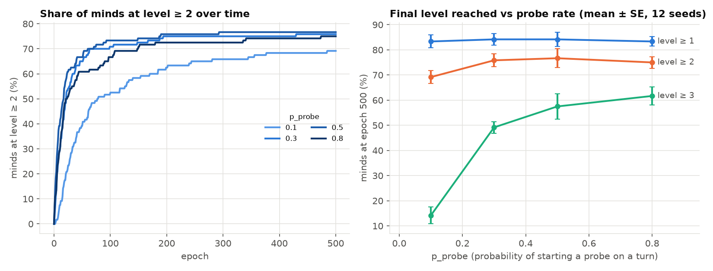
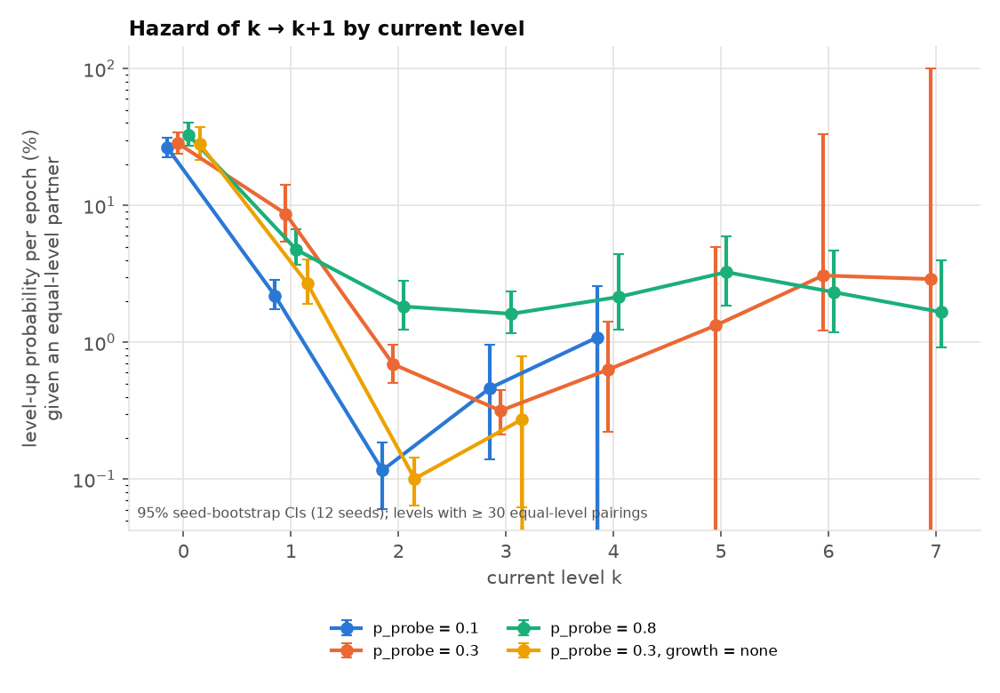
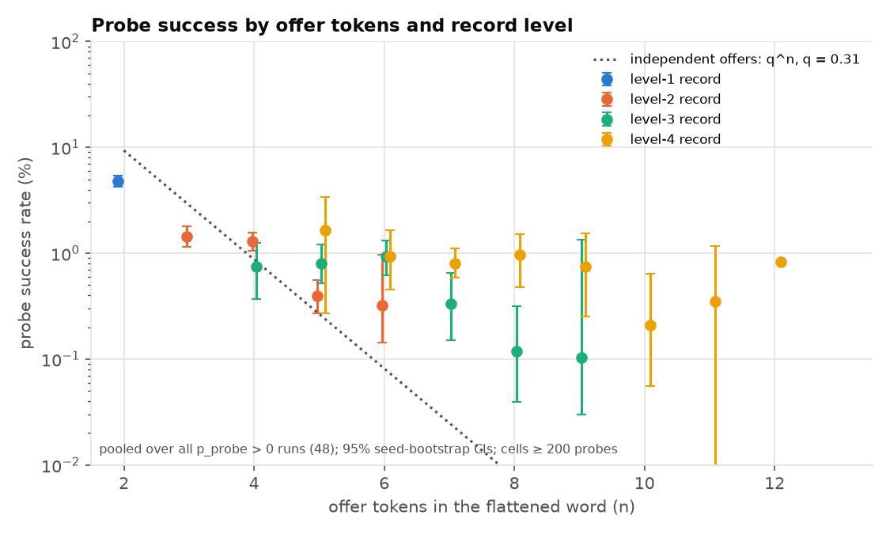
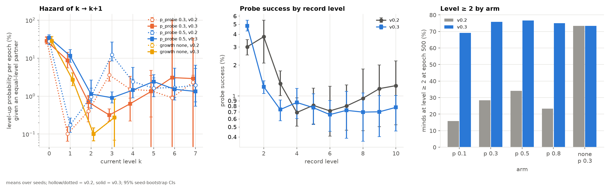

# E4 under spec v0.3 — Autocatalysis re-run (G4c)

**Question (unchanged).** Do probes accelerate development, and does development feed on itself (the hazard of the next step rising with depth)?
**What changed.** Spec v0.3 (D10) gives each grown node a τ exit back to its anchor, so grown nodes no longer trap minds. Baseline: `results/E4.md` (v0.2, tag `v0.2-results`).
**Verdict.** Removing the trap changes the picture a lot: far more minds develop, the 1 → 2 bottleneck is gone, growth now helps, and more probing keeps helping up to p_probe = 0.8. But there is **still no autocatalysis**. The per-epoch chance of the next step **falls** with level and then stays flat at about 1% per epoch. The same minds, followed from level to level, climb *more slowly* at each step. Probe success still falls with record level.

## 1. Plain summary

With the design flaw fixed, learners no longer get locked into a dead end after their first success. About three in four now pass the second step, compared with one in four to one in three before. The model's growth rule now clearly helps: it lets learners go several steps further than they can without it. Practising more often also helps, up to the highest rate we tried. Learning still does not snowball. Each further step is harder than the one before, or at best equally hard, even for the same learners. Practice attempts on deeper material still fail more often.

## 2. Method and commands

The design is the same as v0.2 (`experiments/default.yaml`: 20 minds, ER p = 0.2, 500 epochs, T_ep = 200, W = 50, q_edge = 0.08, θ = 0.4, bootstrap mode, growth `generalize`, 12 seeds 0–11 per arm), with one exception. **The p_probe grid is cut to {0.1, 0.3, 0.5, 0.8}** to fit ~30 min on 2 workers (v0.3 runs are ~2× slower, since minds develop further and probe longer words). Dropped arms:
- p_probe = 0 is capped at level 1 by construction (§5.3), which v0.3 does not change;
- 0.05 and 0.2 are dose–response infill.

The growth = none arm (p_probe 0.3) was re-run as well.

```bash
# 48 runs, 28.5 min wall on 2 workers (machine shared with 4 other agents)
uv run python -m experiments.E4 --tag E4_pprobe_v03 --seeds 12 --workers 2 --grid p_probe=0.1,0.3,0.5,0.8
# 12 runs, 3.2 min
uv run python -m experiments.E4 --tag E4_growth_v03 --seeds 12 --workers 2 --grid growth=none
# tables results/E4_v03_tables.md, figures results/E4_v03_{development,hazard,probe_success}.png
uv run python -m experiments.E4_analyze --suffix _v03 --p-values 0.1,0.3,0.5,0.8
# side-by-side with the v0.2 npz files (from the G4b E4 worktree) -> results/E4_v03_compare.{md,png}
uv run python -m experiments.E4_compare --v02 <v0.2 outputs dir containing E4_pprobe/ and E4_growth/> --v03 outputs --suffix _v03
```

The scripts are the v0.2 ones. `E4_analyze.py` gained `--suffix` and `--p-values` flags, and its defaults reproduce the v0.2 run. `E4_compare.py` is new: it adds the side-by-side table, a fixed-cohort hazard, the repeat-partner share (the same logic as `E4_repeat.py`) and a late-development share. The v0.2 inputs were read from `.claude/worktrees/agent-a90312ecfc3c85594/outputs/`. `E4_traps.py` was not re-run: under v0.3 no grown node can be absorbing, by construction (τ exit, covered by `tests/test_graph.py`).

**Sanity check.** growth = none grows no nodes, so v0.3 cannot change it. Its 12 level trajectories are **identical** to v0.2's.

**Hazard and uncertainty.** These are as in v0.2. h_eq(k) = P(level up this epoch | partner is at the same level k); every level-up occurred in such a pairing (asserted). Mean ± SE over seeds for per-run shares; 95% seed-cluster bootstrap for pooled rates.

## 3. Results (v0.3)

### (a) Development vs probe rate

| p_probe | mean level | ≥1 | ≥2 | ≥3 | ≥4 | max (median [range]) | first pair at L3 (epoch) | contingency computable |
|---|---|---|---|---|---|---|---|---|
| 0.1 | 1.72 ± 0.08 | 83 ± 3% | 69 ± 3% | 14 ± 3% | 4 ± 2% | 3 [2–5] | 118 [30–352] (9/12) | 100% |
| 0.3 | 2.41 ± 0.11 | 84 ± 2% | 76 ± 3% | 49 ± 2% | 16 ± 2% | 4 [3–10] | 14 [4–46] (12/12) | 100% |
| 0.5 | 3.20 ± 0.22 | 84 ± 3% | 77 ± 4% | 58 ± 5% | 36 ± 5% | 8 [5–10] | 8 [1–20] (12/12) | 99% |
| **0.8** | **3.86 ± 0.24** | 83 ± 2% | 75 ± 2% | **62 ± 4%** | **48 ± 4%** | 10 [6–10] | 4 [1–26] (12/12) | 91% |
| 0.3, growth = none | 1.78 ± 0.04 | 87 ± 1% | 73 ± 1% | 15 ± 2% | 3 ± 1% | 3 [2–4] | 75 [12–402] (11/12) | 99% |

- Level ≥2 plateaus at ~75% from p_probe 0.3 on. The ~16% stranded at level 0 plus a few at level 1 make up the rest.
- Deeper levels rise **monotonically** with p_probe up to 0.8 (≥4: 4 → 16 → 36 → 48%). There is no interior optimum in this grid.
- Development no longer freezes by epoch ~60: 21 ± 1% of level-steps happen after epoch 100 (v0.2: 10 ± 1%). See `E4_v03_development.png`.



### (b) Hazard by level

h_eq(k), % per epoch [95% CI]:

| k → k+1 | p = 0.1 | p = 0.3 | p = 0.5 | p = 0.8 | p = 0.3, none |
|---|---|---|---|---|---|
| 0 → 1 | 26 [23, 32] | 28 [24, 35] | 35 [30, 42] | 33 [27, 41] | 28 [21, 37] |
| 1 → 2 | 2.2 [1.7, 2.9] | **8.7** [5.5, 14] | **11.5** [7.8, 17] | 4.8 [3.7, 6.5] | 2.7 [1.9, 4.1] |
| 2 → 3 | 0.12 [0.06, 0.18] | 0.69 [0.51, 0.96] | 1.1 [0.8, 1.6] | 1.8 [1.2, 2.9] | 0.10 [0.07, 0.14] |
| 3 → 4 | 0.46 [0.15, 0.93] | 0.32 [0.22, 0.46] | 0.91 [0.66, 1.3] | 1.6 [1.2, 2.4] | 0.27 [0.07, 0.84] |
| 4 → 5 | 1.1 [0, 2.9] | 0.63 [0.22, 1.4] | 1.4 [0.9, 2.8] | 2.1 [1.2, 4.3] | – |
| 5 → 6 | 0 [0, 0] | 1.3 [0, 4.8] | 2.4 [1.6, 3.7] | 3.3 [1.9, 5.8] | – |

- The first probe-based step is no longer a wall: h(1 → 2) is 8.7–11.5% at p 0.3–0.5, **70–90× the v0.2 value**.
- The steep drop now comes one step later, at 2 → 3 (≈ 1%/epoch). After that the hazard is **flat at roughly 0.3–3%** per epoch. At p ≥ 0.5 it drifts up slightly from k = 3 to k = 5, but the CIs overlap.
- **Fixed-cohort check (new).** Take the minds that finished at level ≥ 5 (158 minds, p 0.3–0.8 pooled) and measure their hazard at each earlier level. The same minds contribute at every k, so between-mind selection cannot create a trend:

| cohort | k=1 | k=2 | k=3 | k=4 | mean epochs spent at k = 1 / 2 / 3 / 4 |
|---|---|---|---|---|---|
| v0.3, final ≥ 5 (158 minds) | 17.5 [12.5, 26] | 8.6 [5.9, 14] | 5.8 [4.3, 8.9] | 5.0 [3.6, 7.8] | 12 / 21 / 42 / 61 |
| v0.2, final ≥ 5 (90 minds) | 35 [27, 48] | 27 [18, 47] | 9.6 [5.7, 20] | 4.5 [2.9, 8.1] | 3 / 11 / 37 / 73 |

  Within the same minds, each step takes longer than the last. **Development does not feed on itself.** The slight rise at depth in the pooled table is selection (only fast pairs are observed there), and v0.2's "recovery" at k = 3–5 was entirely selection too.



### (c) Probe success by record level

Pooled over p_probe 0.1–0.8, % [95% CI]:

| record level | 1 | 2 | 3 | 4 | 5 | 6+ |
|---|---|---|---|---|---|---|
| v0.3 | **4.8** [4.3, 5.5] | 1.2 [1.1, 1.4] | 0.74 [0.57, 0.92] | 0.87 [0.60, 1.2] | 0.77 [0.53, 1.1] | 0.70 [0.49, 0.93] |

- **Probe success still falls with level**, mostly in one drop from L1 to L2 (4×), and is flat at ~0.7–0.9% from L3 on.
- The first exchange is still the filter. My first offer passes more often than in v0.2 (41.9% vs 26%), because minds are no longer stuck with two sync labels. The partner's first answer does not improve (16.1% vs 17%; OTHER_OFFER passes 21.4% in both versions). Later positions pass at 65–84%.
- Success falls far more slowly than independent offers predict (q = 0.31: q^10 ≈ 0.001% vs observed 0.85% at 10 offer tokens).



### (d) Growth `generalize` vs `none` (p_probe 0.3)

| growth | mean level | ≥2 | ≥3 | ≥4 | max | h 1 → 2 |
|---|---|---|---|---|---|---|
| generalize | **2.41 ± 0.11** | 76 ± 3% | **49 ± 2%** | **16 ± 2%** | 4 [3–10] | **8.7%** [5.5, 14] |
| none | 1.78 ± 0.04 | 73 ± 1% | 15 ± 2% | 3 ± 1% | 3 [2–4] | 2.7% [1.9, 4.1] |

Generalize now **beats** none. Level ≥2 ties, but generalize has 3× the minds at level ≥3 and 5× at ≥4, and a 3× faster 1 → 2 step.

### (e) Partners

89–91% of level-ups beyond level 1 are with the previous level-up partner in v0.2; in v0.3 it is **83%** (1408/1688), against 66% under growth = none and roughly 25% by chance. Deep climbs are still overwhelmingly done by the same pair.

## 4. v0.2 vs v0.3 side by side



| claim (v0.2, `results/E4.md`) | v0.2 number | v0.3 number | status |
|---|---|---|---|
| Probes are necessary past level 1 | by construction | by construction | **survives** (trivial) |
| Severe 1 → 2 bottleneck (~300× harder than 0 → 1) | h 0.06–0.17% | h 2.2–11.5% (3–12× below 0 → 1) | **reverses**: the bottleneck was the trap. A milder drop now sits at 2 → 3 (~1%) |
| Hazard rises again at k ≥ 3 (U shape), confounded | 4–20% at k 3–5 | flat 0.3–3% | **changes**: no recovery; the fixed cohort shows a monotone decline in both versions |
| No autocatalysis | — | fixed cohort 17.5 → 8.6 → 5.8 → 5.0% | **survives**, on firmer ground |
| Optimum p_probe ≈ 0.5; 0.8 backfires | ≥2: 34% (0.5) vs 23% (0.8) | ≥2 flat ~75%; ≥4 36% → 48% | **reverses**: more probing keeps helping (only the grid 0.1–0.8 was tested) |
| growth = none beats generalize | ≥2: 73% vs 28% | ≥2: 73% vs 76%; ≥3: 15% vs 49% | **reverses** |
| Probe success low and falling with level | 3.0 / 3.8 / 1.3 / 0.7% (L1–4) | 4.8 / 1.2 / 0.7 / 0.9% | **survives**, with a new shape: one drop L1 → L2, then flat |
| First exchange is the filter | pos0 26%, pos1 17% | pos0 42%, pos1 16% | **survives**; the partner's first reply is now the sole bottleneck |
| Development freezes after ~60 epochs | 10% of steps after e100 | 21% | **weakened** |
| Deep climbs are by the same pair | 91% same partner | 83% | **survives**, slightly weaker |
| 12–17% stranded at level 0 | 16% | 16% | **unchanged** (a bootstrap-mode property) |
| Contingency computability drops under growth | 88% (p 0.3) | 100% | **reverses** (it was a trap symptom) |

## 5. Caveats

1. Reduced p_probe grid (no 0, 0.05, 0.2), so the dose–response has 4 points. Whether an optimum exists above 0.8 is untested. Computability starts to dip at 0.8 (91%).
2. Hazards at k ≥ 4 rest on few pairs per arm (wide CIs, some with a lower bound of 0). The fixed-cohort table pools p 0.3–0.8 to get 158 minds. Its conditioning on "final level ≥ 5" is common to all k, but the per-k hazards still mix arms with different probe rates.
3. The hazard counts "at least one step" per epoch. Multi-level jumps within an epoch are rarer than level-ups but not negligible at high p (84 at p 0.8).
4. The v0.2 comparison data were read from the G4b worktree's `outputs/` (gitignored). The v0.2 numbers here match `results/E4.md` exactly, but reproducing them needs that directory or a re-run at tag `v0.2-results`.
5. The same-partner share is still 83%, so "a pair's shared vocabulary" is still the main route to depth. Without the trap, it is no longer forced.

## Recommended shared-code changes (not made)

- The v0.2 requests still stand: a per-epoch callback / `levels` array in `sim/runner.run`, and per-agent levels by id in `experiments/sweep.py`. E4 still duplicates the run loop.
- `experiments/E4_traps.py` and `E4_repeat.py` have hardcoded tags and are superseded for v0.3 by `E4_compare.py`. Consider retiring them.
