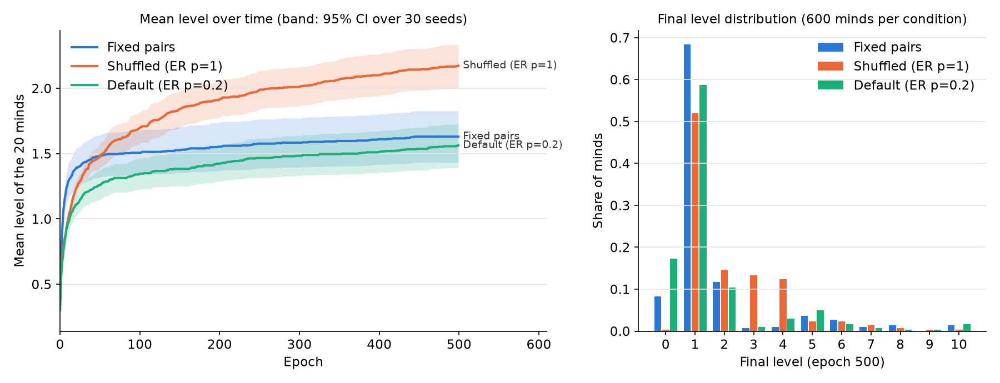
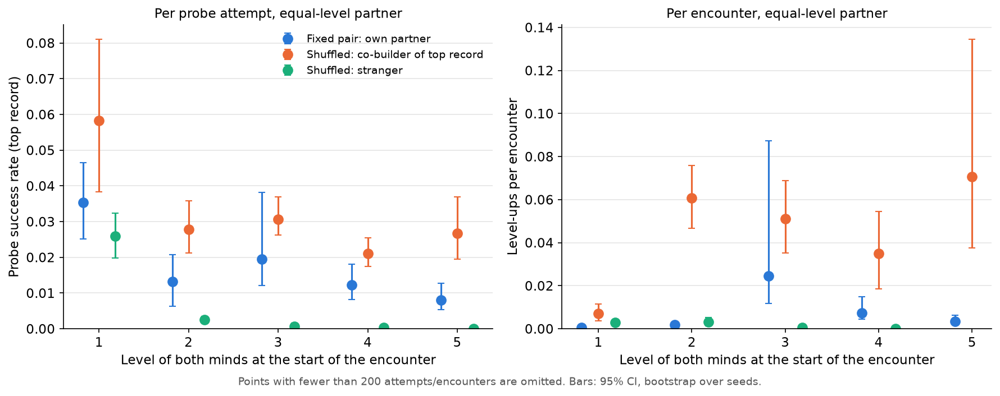

# E5 — Private languages

Segment G4b · 2026-09-29 · spec v0.2 defaults (q_edge 0.08, θ 0.4) · 30 seeds × 3 conditions × 500 epochs, 20 minds

## 1. Plain summary

We tested whether two simulated minds that first "recognized" each other form a private language, so that they later make progress together more easily than they would with strangers. They do. When they meet again, the routines they learned together succeed about three times as often as the same routines tried on a stranger, and a joint step up is about 17 times more likely. The reason is mostly mundane: each mind's repertoire shrinks to the moves it learned, and partners who learned together hold matching halves. Even so, locking minds into permanent pairs made the population develop more slowly, not faster. A mind stuck with an unsuitable partner can never try anyone else, while in a shuffled population it soon meets someone it can work with.

## 2. Method

**Conditions.** All use the §9 defaults (20 minds, no controls, 500 epochs, bootstrap mode), and the same seeds 0–29 in each condition.

| Condition | Config | Contact |
|---|---|---|
| (a) fixed pairs | `experiments/E5_pairs.yaml` | `pairs`: 10 fixed pairs, each meets every epoch |
| (b) shuffled | `experiments/E5_shuffled.yaml` | `erdos_renyi`, p_contact = 1: complete graph, so a new random perfect matching every epoch |
| (c) default | `experiments/E5_er02.yaml` | `erdos_renyi`, p_contact = 0.2: fixed sparse graph (0.82 encounters per mind per epoch) |

**Instrumented loop** (`experiments/E5.py`). This is a copy of `sim.runner.run` that makes the same RNG calls in the same order, so each run has exactly the runner's trace hash (checked in `tests/test_E5.py`). At the start of every episode each mind *i* classes its partner *j* as follows:

- **co-builder**: *j* is the partner of *i*'s current top record;
- **past**: *i* leveled up with *j* before, but not for its current top record;
- **stranger**: *i* has never leveled up with *j*.

Each probe (START → SUCCESS, ABORT, or unfinished at episode end) is attributed to the prober's partner class, both minds' levels at episode start, and the level of the probed record. The loop also records whether the partner had a probe open on any tick of this probe ("co-probing"). Every encounter is recorded with both levels and the number of level-ups it produced.

**Main comparison.** For minds at equal levels (bootstrap needs equal levels) the loop compares (i) the success rate of probes of the **top** record, which is the only record that can lead to a level-up, and (ii) level-ups per encounter. Both rates are per attempt or per encounter, never totals, because fixed partners meet far more often. The two classes differ in level mix, so the ratio is indirectly standardized by level: observed co-builder events ÷ the events expected if co-builders had the strangers' rate at each level.

**Record overlap.** At the end of each run the loop compares every pair of minds' level-k records (k = 1–3). "Co-built" means each record names the other mind as `partner_id`. It uses four measures:

- Jaccard overlap of the offered labels in the two extras;
- Jaccard overlap of *i*'s own-move labels with the complements of *j*'s own-move labels, over the flat words (in a shared exchange, *i* offers σ where *j* answers σ̄);
- **swap-interlock**: some odd phase shift of swap(extras_j) lies on extras_i with no clash between concrete tokens, at least 2 overlapping tokens and at least 1 matched offer;
- for each mutual bootstrap, whether the two partners' qualifying segments share a tick.

**Diagnostic** (`experiments/E5_diag.py`, 3 seeds × 300 epochs). This script breaks the §5.3 condition down per window for equal-level encounters that produced no level-up. For each part it gives how often it holds: top-record probe success, extension found, contingency computable, and contingency ≥ θ. It also reports how many sync labels are available and the share of minds sitting on a node created by growth.

**Uncertainty.** 95% percentile intervals from a cluster bootstrap over seeds (2,000 resamples). Each seed is one population.

**Commands** (about 17.5 min wall time on 3 workers, plus about 1.5 min for the diagnostic):

```
uv run python -m experiments.E5 run --seeds 30 --workers 3     # -> outputs/E5/<cond>/s<seed>.json
uv run python -m experiments.E5_analyze                          # -> outputs/E5/summary.json, results/E5_*.png
uv run python -m experiments.E5_diag --seeds 3 --epochs 300     # -> outputs/E5/diag.json
```

## 3. Results

### 3.1 Level distributions and rates (final epoch, mean over 30 seeds [95% CI])

| | Fixed pairs | Shuffled (p=1) | Default (p=0.2) |
|---|---|---|---|
| level ≥ 1 | 91.7% [88.7, 94.3] | **99.7%** [99.0, 100] | 82.7% [80.3, 84.7] |
| level ≥ 2 | 23.3% [18.3, 28.7] | **47.7%** [43.0, 52.3] | 24.0% [18.7, 29.3] |
| level ≥ 3 | 11.7% [8.0, 15.3] | **33.0%** [29.0, 37.0] | 13.7% [10.7, 16.3] |
| mean level | 1.63 [1.43, 1.83] | **2.17** [2.02, 2.34] | 1.56 [1.41, 1.73] |
| mean of per-seed max level | 5.2 [4.1, 6.3] | 5.2 [4.6, 5.9] | 5.5 [4.6, 6.5] |
| still at level 0 | 8.3% (25 pairs) | 0.3% | 17.3% |
| level-ups per mind per epoch | 0.00326 [0.00288, 0.00365] | **0.00435** [0.00402, 0.00468] | 0.00313 [0.00283, 0.00348] |
| level-ups per encounter | 0.00326 | 0.00435 | 0.00380 [0.00342, 0.00422] |
| encounters at equal level | 100% | 36% | 48% |
| repeat-partner fraction | 0.39 [0.32, 0.45] | 0.30 [0.26, 0.34] | 0.35 [0.29, 0.39] |



Fixed pairs develop fastest for about the first 50 epochs, then stall. From epoch 50 on the shuffled population is ahead, and by epoch 500 it has about twice as many minds at level 2 or above. The default sparse graph ends about where fixed pairs do. There is no condition-level evidence that fixed pairs "climb faster together".

**Level-ups per encounter between equal-level minds, by starting level:**

| from level | Fixed pairs | Shuffled | Default |
|---|---|---|---|
| 0 → 1 | 0.022 [0.016, 0.033] | 0.30 [0.27, 0.34] | 0.31 [0.27, 0.37] |
| 1 → 2 | 0.00051 [0.00035, 0.00069] | 0.0030 [0.0023, 0.0040] | 0.0012 [0.0008, 0.0017] |
| 2 → 3 | 0.0019 [0.0013, 0.0028] | 0.017 [0.013, 0.022] | 0.0061 [0.0038, 0.011] |

Fixed pairs are 6–14× slower at every early step. At level 0 this is a partner lottery. A shuffled mind that fails with one partner gets a new one the next epoch. 25 of the 300 fixed pairs never bootstrapped in 500 epochs, compared with 2 of 600 shuffled minds.

**Repeat-partner fraction.** In fixed pairs this number is fixed by construction: every level-up after a pair's first is a repeat, so it only measures how far pairs climb. The notable value is the shuffled one. There, 30% of level-ups are with a previous level-up partner, although each mind has 19 possible partners and meets each one about 5% of the time. Former partners are strongly over-represented among successful level-ups.

### 3.2 Key test: same agent, co-builder vs stranger, equal level

The within-population comparison is clean only in the shuffled and default conditions, where a mind meets both co-builders and strangers at its own level. Fixed pairs never meet a stranger.

| Top-record probes, equal-level partner | Shuffled | Default (p=0.2) |
|---|---|---|
| success rate with co-builder | **4.5%** [3.4, 5.8] | **2.5%** [1.7, 3.5] |
| success rate with past partner | 0.7% [0.07, 1.5] (n = 9.5k) | 0% (n = 1.5k) |
| success rate with stranger | 2.3% [1.8, 2.9] | 1.3% [0.9, 1.8] |
| **level-standardized ratio, co-builder / stranger** | **2.9×** [2.3, 3.9] | **2.1×** [1.3, 3.4] |
| **level-ups per encounter, standardized ratio** | **16.7×** [11.2, 24.1] | 2.3× [1.04, 9.3] |



In the shuffled condition the advantage grows with level (probe success, co-builder vs stranger):

| level | co-builder | stranger |
|---|---|---|
| 1 | 5.8% | 2.6% |
| 2 | 2.8% | 0.26% |
| 3 | 3.1% | 0.06% |
| 4 | 2.1% | 0.03% |

Above level 2, a stranger at the same level almost never completes your top probe. From level 2 upward, 93% of shuffled level-up events (356 of 384) were with the co-builder of the current top record, although co-builders were only 31% of the equal-level encounters at those levels. The advantage belongs only to that co-builder: former partners who helped build a lower record do worse than strangers, though on small numbers.

**Across conditions.** A fixed partner compared with a same-level stranger in the shuffled population: probe success is 1.43× higher [1.03, 1.98], but level-ups per encounter are 0.52× [0.32, 0.72]. Fixed partners at level 1 are mostly pairs that have already failed to climb for hundreds of epochs, so a better probe rate does not become level-ups. This is a selection effect, not a per-probe handicap.

### 3.3 Do co-builders' records overlap?

Shuffled condition (the other two are similar; full table in `outputs/E5/summary.json`):

| | L1 co-built | L1 other | L2 co-built | L2 other | L3 co-built | L3 other |
|---|---|---|---|---|---|---|
| n record pairs | 299 | 5,364 | 143 | 1,172 | 99 | 536 |
| offered-label Jaccard, extras | 0.37 | 0.21 | 0.45 | 0.18 | 0.47 | 0.21 |
| own vs partner's complement, flat | 0.36 | 0.21 | **0.85** | 0.24 | **1.00** | 0.22 |
| plain own-label Jaccard, flat | 0.20 | 0.21 | 0.28 | 0.25 | 0.27 | 0.22 |
| swap-interlock (≥ 1 matched offer) | 0 * | 0 * | **23%** | 6.5% | **28%** | 9.0% |

\* Level-1 words of the two partners overlap on only one tick (*i*'s segment ends with the offer where *j*'s begins), so the ≥ 2-token rule never fires at level 1. Tick-level provenance shows that in 47–51% of mutual bootstraps the two partners' qualifying segments share a tick. Their words are literally two views of the same exchange.

Co-builders' vocabularies are **complementary rather than shared**. From level 2 on, the moves one partner learned are almost exactly the complements of the moves the other learned. Plain own-label overlap is at chance.

**Mechanism.** The co-probing and diagnostic results together point to these three causes:

1. **Vocabulary through growth.** The diagnostic shows 89–100% of shuffled and default minds at level ≥ 1 sitting on a node created by growth (60% for fixed pairs at level 1, 70–100% above). From level 3 on they have exactly 2 available sync labels. A grown node's only out-edges are self-loops (§6), so it is absorbing, and the mind's repertoire collapses to the labels it has learned. A co-builder has learned the complements, so it can answer the probe. A stranger usually cannot.
2. **Co-probing.** A probe succeeds 11.7% [8.9, 14.5] of the time when the partner is also probing, against 1.3% [1.1, 1.6] otherwise (shuffled). The partner has a probe open during 26% of probes aimed at a co-builder, against 10% for a stranger. 65% of successful co-builder probes overlapped a partner probe.
3. **Word alignment.** Only weak support: about a quarter of co-built level-2 and level-3 pairs interlock under the perspective swap, against 6–9% by chance.

## 4. Interpretation against the private-language hypothesis (§14)

*"Pairs who bootstrapped together climb faster together because their probes interlock."*

- **Per encounter: supported.** At equal level, a mind's top probe succeeds 2–3× more often with the partner it built that record with. Their joint level-up rate is roughly 17× higher in the shuffled population. This is a strong private-language effect, and it gets stronger with level: above level 2, strangers almost never complete each other's probes.
- **Mechanism: partly as hypothesized.** The probes do interlock, but mostly because the two minds learned complementary moves, both through §6 growth and through positions that end up on absorbing grown nodes. Aligned token sequences contribute little. The language is private because the two vocabularies are complementary halves of one exchange.
- **At the population level: refuted as stated.** Locking minds into fixed pairs makes development slower (mean level 1.63 vs 2.17, level ≥ 2 23% vs 48%). The private-language advantage is real, but it is outweighed by the cost of never escaping a bad match. The best condition is a shuffled population. There a mind can find a compatible partner, and after that it mostly climbs with that same partner, as the 30% repeat rate against about 5% chance shows. In this model a private language forms by choice, not by confinement.

## 5. Surprises and caveats

- **Grown nodes are absorbing (model issue, affects all experiments).** Under `generalize`, the new node v receives only anchor → v plus self-loops, so once a mind steps onto v it never leaves. Nearly every developed mind ends up there with a repertoire of 2–3 learned labels. That is what makes partners so specific. Whether this is intended matters for E1–E4 as well (see recommendations below).
- **Past partners are worse than strangers** (0.7% vs 2.3%, small n). Once a mind has climbed with someone else, its top record's vocabulary no longer fits the old partner.
- **Selection confounds.** "Co-builder at equal level" selects pairs who both just climbed together, and those minds may simply be better placed in their graphs. Strangers at the same level include minds that are stuck. The comparison is within a population and level-standardized, but not within an individual mind. The cross-condition ratios in §3.2 are confounded by survivorship.
- **Default condition.** 17% of minds stay at level 0, largely because a sparse ER graph leaves some minds with few or no contacts, or with contacts that are poor matches. That is not a private-language effect.
- **Unfinished probes** at the end of an episode count as failures, the same for all classes.
- **The swap-interlock measure is strict** (≥ 2 overlapping tokens) and undercounts level-1 interlock by design. Segment overlap is the better level-1 measure.
- The effects at high levels (≥ 5) rest on few encounters, and the intervals are wide.

## 6. Suggested follow-ups

1. **Within-mind test:** a paired comparison of each mind's top-probe success with its co-builder against with strangers, which removes the between-mind quality confound.
2. **Growth ablation:** rerun E5 with `growth: none`, and with a variant where grown nodes get a way back (for example v → anchor on τ), to separate vocabulary lock-in from true word interlock.
3. **Partner switching:** fixed pairs that are allowed to re-pair after X epochs without progress. Is there an optimal "commitment" time between the fixed and fully shuffled extremes?
4. **Intermediate p_contact** (0.3–0.8), to see whether the benefit of shuffling is monotone in the number of available partners (overlaps with E3).
5. **Elder mode against a private language:** can a stranger at a higher level transmit into a pair's private vocabulary, or does complementarity block it (overlaps with E1)?
