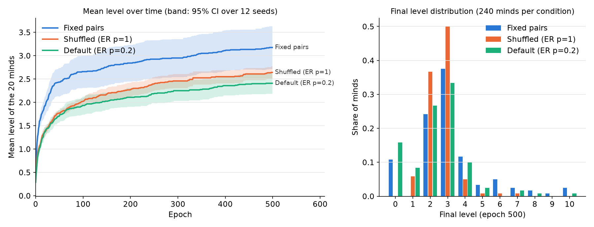
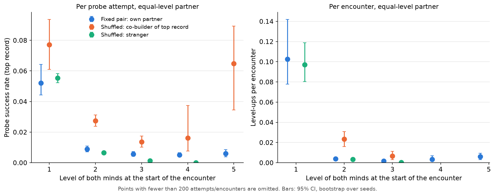

# E5 under spec v0.3 — Private languages, re-run

Segment G4c · 2026-09-30 · spec v0.3 (grown nodes get a τ exit back to their anchor, NOTEBOOK D10) · defaults otherwise (q_edge 0.08, θ 0.4) · **12 seeds** × 3 conditions × 500 epochs, 20 minds. Baseline: `results/E5.md` (spec v0.2, tag `v0.2-results`).

## 1. Plain summary

Minds that made progress together still understand each other better than strangers do. A mind's latest routine works about 3.7 times as often with the partner it learned it with as with an equally advanced stranger, and a joint step up is about 5 times as likely. Under the old rules this could have been explained by minds getting stuck with only a couple of moves left. That no longer happens, and the effect remains, so it is a real "private language" and not a side effect of the bug. What reverses is the population picture. Permanent pairs now develop further than shuffled minds, because a shuffled mind rarely meets the one partner who understands it, while a fixed pair meets every day. The cost of permanent pairs remains: about one pair in nine never gets started at all.

## 2. Method and commands

The design, configs, scripts and analysis are unchanged from `results/E5.md` §2: fixed pairs, shuffled (ER p = 1) and default (ER p = 0.2); an instrumented loop that is hash-identical to the runner; partner classes co-builder / past / stranger; level-standardized ratios; and a cluster bootstrap over seeds (2,000 resamples, 95% percentile intervals). The only code change is output plumbing in `experiments/E5_analyze.py`: `--prefix` sets the figure file names and `--in` sets the run directory. `experiments/E5_compare.py` prints two summaries side by side.

**Budget.** v0.3 runs take about 94 s each on this machine (v0.2: about 40 s), partly because minds climb further and partly because of shared load. With 2 workers, 30 seeds would take about 70 min, so I ran seeds 0–11 (36 runs, 26.6 min wall time). Jobs are ordered seed by seed, so this is exactly `--seeds 12`. **All v0.2 numbers below are recomputed on the same seeds 0–11** from the preserved v0.2 per-seed outputs. They agree with the 30-seed v0.2 report within its intervals, and §4 quotes both where they differ.

```
# v0.3 (this worktree, current code)
uv run python -m experiments.E5 run --seeds 12 --workers 2                # -> outputs/E5/<cond>/s0..s11.json  (26.6 min)
uv run python -m experiments.E5_analyze --prefix E5_v03                    # -> outputs/E5/summary.json, results/E5_v03_*.png
uv run python -m experiments.E5_diag --seeds 3 --epochs 300 --workers 1   # -> outputs/E5/diag.json

# v0.2 baseline on the same seeds (per-seed JSONs from the G4b E5 run, copied to outputs/E5_v02_s12/;
# or regenerate with `git checkout v0.2-results && uv run python -m experiments.E5 run --seeds 12`)
uv run python -m experiments.E5_analyze --in outputs/E5_v02_s12 --prefix scratch   # figures discarded
uv run python -m experiments.E5_compare outputs/E5_v02_s12/summary.json outputs/E5/summary.json
```

## 3. v0.3 results

### 3.1 Development by condition (final epoch, mean over 12 seeds [95% CI])

| | Fixed pairs | Shuffled (p=1) | Default (p=0.2) |
|---|---|---|---|
| level ≥ 1 | 89.2% [85.0, 93.3] | **100%** | 84.2% [80.0, 88.3] |
| level ≥ 2 | 89.2% [85.0, 93.3] | **94.2%** [91.7, 96.7] | 75.8% [70.8, 80.0] |
| level ≥ 3 | **65.0%** [56.7, 72.5] | 57.5% [51.7, 63.3] | 49.2% [45.0, 53.3] |
| level ≥ 4 | **27.5%** [20.8, 34.2] | 7.5% [2.5, 12.5] | 15.8% [11.7, 20.0] |
| mean level | **3.18** [2.78, 3.64] | 2.64 [2.52, 2.77] | 2.41 [2.20, 2.62] |
| mean of per-seed max level | **6.3** [5.3, 7.4] | 4.0 [3.3, 4.8] | 5.4 [4.3, 6.6] |
| still at level 0 | 10.8% (13 of 120 pairs) | 0% | 15.8% |
| level-ups per mind per epoch | **0.00635** [0.00557, 0.00733] | 0.00528 [0.00503, 0.00553] | 0.00482 [0.00442, 0.00523] |
| repeat-partner fraction of level-ups | 0.68 [0.62, 0.73] | 0.18 [0.14, 0.23] | 0.51 [0.45, 0.56] |



Mean level at epochs 25 / 100 / 500: fixed pairs 2.06 / 2.66 / 3.17, shuffled 1.45 / 2.02 / 2.64, default 1.44 / 1.93 / 2.41. **Fixed pairs lead at every epoch**, and all three conditions are still rising at epoch 500. Every fixed pair that bootstraps reaches level 2: no mind ends at level 1. Shuffled minds pile up at levels 2–3 (87%) and rarely pass 3.

**Level-ups per equal-level encounter, by starting level:**

| from level | Fixed pairs | Shuffled | Default |
|---|---|---|---|
| 0 → 1 | 0.018 [0.013, 0.030] | 0.31 [0.25, 0.37] | 0.31 [0.26, 0.39] |
| 1 → 2 | 0.10 [0.078, 0.14] | 0.11 [0.088, 0.13] | 0.088 [0.055, 0.15] |
| 2 → 3 | 0.0038 [0.0030, 0.0046] | 0.0048 [0.0038, 0.0062] | 0.0070 [0.0052, 0.0097] |
| 3 → 4 | 0.0018 [0.0011, 0.0028] | 0.0011 [0.0004, 0.0019] | 0.0032 [0.0021, 0.0046] |

The 1 → 2 step is no longer a bottleneck (about 0.1 per encounter everywhere). The hard steps are now 2 → 3 and 3 → 4. From level 1 up, fixed pairs climb at rates comparable to the others per encounter (within about 2×). They are far slower only at 0 → 1: the partner lottery.

### 3.2 Key test: same population, co-builder vs stranger, equal level

| Top-record probes, equal-level partner | Shuffled | Default (p=0.2) |
|---|---|---|
| success rate with co-builder | **2.35%** [2.00, 2.73] | **1.62%** [1.42, 1.91] |
| success rate with past partner | 0.54% [0.35, 0.74] | 0.65% [0.57, 0.76] |
| success rate with stranger | 0.79% [0.70, 0.90] | 0.72% [0.54, 0.93] |
| **level-standardized ratio, co-builder / stranger** | **3.73×** [3.12, 4.33] | **2.22×** [1.49, 3.31] |
| **level-ups per encounter, standardized ratio** | **4.77×** [3.19, 6.90] | **2.47×** [1.31, 4.65] |



By level (shuffled), top-probe success with co-builder vs stranger: L1 7.7% vs 5.5%; **L2 2.7% vs 0.65%**; **L3 1.35% vs 0.13%**; L4 1.6% (50/3,097) vs 0% (0/2,910). The advantage still **grows with level**, and above level 2 a stranger almost never completes your top probe.

From level 2 up, co-builders are only **10%** of the shuffled minds' equal-level encounters but produce **46%** of their level-ups (76 of 166). In the default graph the figures are 61% of encounters and 91% of level-ups. Past partners are still no better than strangers.

**Across conditions**, comparing a fixed partner with a same-level stranger in the shuffled population: probe success 1.62× [1.23, 2.00], level-ups per encounter 1.41× [0.97, 1.97].

### 3.3 Record overlap and mechanism

| Shuffled | L1 co-built | L1 other | L2 co-built | L2 other | L3 co-built | L3 other |
|---|---|---|---|---|---|---|
| n record pairs | 120 | 2,160 | 113 | 1,908 | 69 | 680 |
| own vs partner's complement, flat (Jaccard) | 0.33 | 0.23 | **0.56** | 0.29 | **0.70** | 0.31 |
| offered-label Jaccard, extras | 0.33 | 0.23 | 0.34 | 0.18 | 0.39 | 0.21 |
| swap-interlock (≥ 1 matched offer) | 0 * | 0 * | **27%** | 9% | **25%** | 10% |

\* Structurally zero at L1, as in v0.2. Segment overlap in mutual bootstraps: 41% (n = 317). The fixed-pair and default conditions show the same pattern (L3 complement Jaccard 0.67 and 0.73 against 0.31–0.34 for other pairs).

**Diagnostic** (`E5_diag`, 3 seeds × 300 epochs, equal-level encounters without a level-up):

| | v0.2 | v0.3 |
|---|---|---|
| minds sitting on a grown node, level ≥ 1 | 60–100% (100% from L3) | **3–34%** (higher only in cells with ≤ 522 encounters: fixed pairs L7 69%) |
| available sync labels | 1.8–3.2 (exactly 2 from L3) | **4.2–5.2** |
| contingency holds per window, L2 / L3 (shuffled) | 13% / 53% | 48% / 48% |

**Co-probing** (shuffled): a probe succeeds 2.16% [1.99, 2.32] of the time when the partner also has a probe open, against 0.46% [0.39, 0.56] when it does not (4.7×). The partner has a probe open during 34% of probes aimed at a co-builder and 27% for a stranger.

**Reading.** The repertoire collapse that v0.2 blamed is gone: minds mostly sit on original nodes, with 4–5 sync labels available. Even so, co-builders' learned moves are still markedly complementary (0.56–0.70 against about 0.3), co-built words still interlock under the perspective swap about 2.5–3× above chance, and the co-builder advantage per probe is at least as large as before (3.7× against 2.7× on the same seeds). The private language now rests on **complementary vocabulary and word interlock without confinement**. Co-probing still helps, but it separates co-builders from strangers much less than it did.

## 4. Side by side: v0.2 vs v0.3 (seeds 0–11 unless noted)

| Quantity | v0.2 | v0.3 | Verdict |
|---|---|---|---|
| Probe success ratio co-builder / stranger (shuffled, std.) | 2.72× [1.96, 3.78] (30 seeds: 2.9×) | **3.73×** [3.12, 4.33] | **Survives**, if anything stronger |
| same, default graph | 2.28× [0.96, 5.55] (30 seeds: 2.1×) | 2.22× [1.49, 3.31] | Survives, now clearly > 1 |
| Level-up ratio co-builder / stranger (shuffled) | 12.2× [5.8, 27.3] (30 seeds: 16.7×) | **4.77×** [3.19, 6.90] | Survives, **3× smaller** |
| Advantage grows with level; strangers ~0 above L2 | yes | yes | Survives |
| Past partner ≤ stranger | 1.05% vs 2.40% | 0.54% vs 0.79% | Survives (weaker) |
| Co-built complementarity L2 / L3 (shuffled) | 0.85 / 1.00 vs 0.25 | 0.56 / 0.70 vs 0.30 | Survives, attenuated |
| Swap-interlock L2 / L3, co-built vs other | 22% / 17% vs 6% / 8% | 27% / 25% vs 9% / 10% | Survives, slightly stronger |
| Mechanism: repertoire shrinks on absorbing grown nodes | 89–100% on grown nodes, 2 labels | 3–33%, 4–5 labels | **Changes**: no longer the explanation |
| Co-probing success lift | 12.5% vs 1.35% (9×) | 2.2% vs 0.46% (4.7×) | Weaker |
| Level ≥ 2: fixed pairs vs shuffled | 20.8% vs **40.8%** | 89.2% vs **94.2%** | Shuffled still ahead, gap small |
| Level ≥ 3: fixed pairs vs shuffled | 10% vs **29%** | **65%** vs 58% | **Reverses** |
| Level ≥ 4: fixed pairs vs shuffled | 10% vs **19%** | **27.5%** vs 7.5% | **Reverses** |
| Mean level: fixed pairs vs shuffled | 1.54 vs **2.01** | **3.18** vs 2.64 | **Reverses** |
| Timing | pairs ahead only until epoch 50–100 | pairs ahead at every epoch | **Reverses** |
| Fixed pairs that never bootstrap | 8 / 120 (30 seeds: 25 / 300) | 13 / 120 | Survives (partner lottery) |
| Main bottleneck | 1 → 2 (0.0004–0.002 per encounter) | 2 → 3 and 3 → 4 | Changes |
| Shuffled repeat-partner fraction (chance ≈ 0.05) | 0.28 | 0.18 | Survives, weaker |
| Fixed partner vs shuffled stranger, level-ups/encounter | 0.43× [0.18, 0.98] | 1.41× [0.97, 1.97] | Reverses (the v0.2 penalty was stuck pairs) |

**Answers to the G4c questions.**

1. *Does the private-language effect survive without the trap?* **Yes.** The per-probe advantage of the co-builder is as large or larger (3.7×), still grows with level, and still rests on complementary learned moves. It is a genuine interlock effect and not a trap artifact. The per-encounter level-up ratio shrank from about 12–17× to about 5×, so part of the v0.2 size did come from the trap.
2. *Do fixed pairs still lose to shuffled contact?* **Mostly no.** Fixed pairs now reach higher levels (mean 3.18 vs 2.64, level ≥ 4 27.5% vs 7.5%) and lead throughout the run. They still pay the partner-lottery cost: 11% of pairs never bootstrap, against none of the shuffled minds, which keeps shuffled marginally ahead at level ≥ 2. The v0.2 conclusion that "a private language forms by choice, not by confinement" is **reversed**. With the trap removed, confinement helps once a pair has bootstrapped, because the only partner who can complete a high-level probe is the co-builder, and a shuffled mind meets that partner in only about 1 of 19 encounters.

## 5. Caveats

- **12 seeds, not 30**, because of the time budget. The main contrasts have non-overlapping intervals, but the fixed-pair mean level is wide ([2.78, 3.64]) because of a few pairs that reach level 10.
- **The v0.2 comparison is on matched seeds**, so the RNG streams diverge as soon as the first grown node is used. Seed pairing does not reduce variance here, and the comparison is effectively between independent samples.
- **Selection confounds** remain as in v0.2. "Co-builder at equal level" selects minds that just climbed together, and the comparison is within a population, not within a mind. The 1.41× cross-condition ratio mixes stuck and productive pairs.
- **Diagnostic sample is small** (3 seeds × 300 epochs), and some cells have few encounters (shuffled L4–L6: 1–3 encounters).
- **Unfinished probes count as failures.** The swap-interlock measure is strict and zero at L1 by construction (as in v0.2).
- **Why shuffled populations stall at L3** (3 → 4 at 0.0011 per encounter, 2 of 12,086 stranger level-ups at L3) is inferred from the partner-class table, not tested directly. An intermediate-commitment experiment (v0.2 follow-up 3) is the natural test.
- Run time per run more than doubled under v0.3, which future budgets should allow for.
